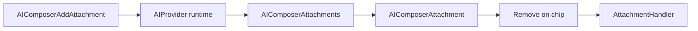

# Composer guide

> **Status:** experimental

Shoreline-styled chat input for AI apps: the **`AIComposer*`** family from `@vtex/shoreline-ai` (pill layout in three arrangements, footer slots, circular send, file attachments, context items, built-in i18n). Draft state lives in the package runtime — mount inside `<AIProvider>`.

Related guides: [RUNTIME.md](./RUNTIME.md) (builder, `AttachmentHandler`), [PROVIDER.md](./PROVIDER.md), [HOOKS.md](./HOOKS.md) (`useAIComposer`, `useAIStatus`).

**Prerequisites:** `<AIProvider runtime={runtime}>` wrapping your chat UI. For file upload, register an `AttachmentHandler` on the runtime builder (see [RUNTIME.md](./RUNTIME.md#attachmenthandler)).

## Setup

```tsx
import '@vtex/shoreline/css'
import '@vtex/shoreline-ai/css'

import { LocaleProvider } from '@vtex/shoreline'
import {
  AIProvider,
  AIComposer,
  AIComposerField,
  AIComposerAttachments,
  AIComposerInput,
  AIComposerFooter,
  AIComposerAddAttachment,
  AIComposerActions,
  AIComposerAction,
} from '@vtex/shoreline-ai'
```

Wrap with `LocaleProvider` so labels and placeholders use the built-in catalogs (`en-US`, `pt-BR`).

## Quick start

Normative tree (matches AI Workspace layout: attachments and textarea inside the pill, footer with left slots + send on the right):

```tsx
<LocaleProvider locale="pt-BR">
  <AIProvider runtime={runtime}>
    <AIComposer loading={isAppLoading}>
      <AIComposerField>
        <AIComposerAttachments />
        <AIComposerInput />
        <AIComposerFooter>
          <AIComposerAddAttachment />
          {/* App slots: agent pill, menus, etc. */}
          <AIComposerActions>
            <AIComposerAction />
          </AIComposerActions>
        </AIComposerFooter>
      </AIComposerField>
    </AIComposer>
  </AIProvider>
</LocaleProvider>
```

## Components

| Component | Purpose |
|-----------|---------|
| `AIComposer` | Root form; `loading` swaps in skeleton; optional `messages` overrides i18n |
| `AIComposerHeader` | Neutral slot above the field: handles position and the overlap with the pill, draws nothing |
| `AIComposerContextItems` | Preset band of context items; place it inside `AIComposerHeader` |
| `AIComposerContextItem` | One removable context item: pin icon, truncated label, optional remove button |
| `AIComposerField` | Pill container (gray-2 surface, focus ring) |
| `AIComposerAttachments` | Pending file chips above the input |
| `AIComposerInput` | Draft textarea |
| `AIComposerFooter` | Bottom row: start slot (left) + actions slot (right) |
| `AIComposerAddAttachment` | `+` button to open the file picker |
| `AIComposerActions` | Right cluster — wrap send/cancel here |
| `AIComposerSend` | Circular send button |
| `AIComposerCancel` | Stop button while a run is streaming |
| `AIComposerAction` | Toggles send ↔ cancel from `useAIStatus()` |
| `AIComposerSkeleton` | Loading placeholder (also used when `AIComposer loading`) |
| `AIComposerAttachment` | Single chip — use only inside `AIComposerAttachments` |

## Composition variants

### Default — `AIComposerAction`

One control that sends when idle and stops while streaming. Send is disabled when the draft is empty (`useAIComposer().disabled`). An attachment that failed to upload does not block it.

```tsx
<AIComposerActions>
  <AIComposerAction />
</AIComposerActions>
```

### Explicit send and cancel

```tsx
import { useAIStatus } from '@vtex/shoreline-ai'

function ComposerSendSlot() {
  const { isStreaming } = useAIStatus()

  return (
    <AIComposerActions>
      {isStreaming ? <AIComposerCancel /> : <AIComposerSend />}
    </AIComposerActions>
  )
}
```

### Loading on `AIComposer`

```tsx
<AIComposer loading={isAppLoading}>
  {/* children ignored while loading */}
</AIComposer>
```

When `loading={true}`, only `AIComposerSkeleton` is rendered — no interactive form.

### Skeleton outside the composer

Use before the provider is ready or in layouts without a full composer:

```tsx
<AIComposerSkeleton />
<AIComposerSkeleton layout="inline" />
```

### Layouts

`layout` on `AIComposer` picks the arrangement. It only sets `data-layout` on the form; the DOM order stays the same, so tab order follows the DOM and can differ from the visual order in `expanded` and `inline`.

| Value | Arrangement | Design states |
|-------|-------------|---------------|
| `stacked` (default) | Text, then a footer row with the start slot on the left and the actions on the right | "ações abaixo do texto", "com contexto" |
| `expanded` | The start slot (the `+`) above the text, actions at the bottom end | "padrão", "enviando", "com anexos" |
| `inline` | One row: start slot, text, actions (minimum height `--sl-space-16`) | "compacta", "com agente", "ações na mesma linha" |

```tsx
<AIComposer layout="inline">…</AIComposer>
```

`AIComposerFooter` is `display: contents` in `expanded` and `inline`, so a `className` or `style` on it has no visual effect there. It finds `AIComposerActions` even inside a Fragment; a custom component that wraps it stays in the start slot.

In `inline` an app can show only the avatar of its agent pill by reading `[data-layout="inline"]` on the form in its own CSS.

### Header and context items

`AIComposerHeader` is a neutral slot placed before `AIComposerField`. It has no background, border or padding. The pill overlaps it by the pill radius, exposed as `--sl-ai-composer-overlap` on the form, so the app can draw anything in it and use the variable as `padding-bottom` to keep its content clear of the pill.

```tsx
<AIComposer>
  <AIComposerHeader>
    <InitiativeCard />
  </AIComposerHeader>
  <AIComposerField>…</AIComposerField>
</AIComposer>
```

`AIComposerContextItems` is the preset for removable chips (for example documents pinned as context). It draws the lighter band, reads the variable to extend behind the pill, and renders nothing when it has no children. The package stores nothing; the app owns the list.

```tsx
<AIComposer>
  <AIComposerHeader>
    <AIComposerContextItems>
      {items.map((item) => (
        <AIComposerContextItem key={item.id} onRemove={() => remove(item.id)}>
          {item.title}
        </AIComposerContextItem>
      ))}
    </AIComposerContextItems>
  </AIComposerHeader>
  <AIComposerField>…</AIComposerField>
</AIComposer>
```

Long labels truncate with an ellipsis; a string label also becomes the `title`. The remove label is localized (`removeContext`) and each remove button is described by the text of its item. Removing an item unmounts its button, so move focus yourself if the user was on it.

With `asChild` the child becomes the item, so the app owns its whole UI and keeps the package attributes and the ref. The default icon, label and remove button are not rendered. The child should be an `li`:

```tsx
<AIComposerContextItem asChild>
  <li>
    <a href={doc.url}>{doc.title}</a>
  </li>
</AIComposerContextItem>
```

An expandable card, like the initiative card in the AI Workspace, needs no package component: the app draws it inside `AIComposerHeader`. See the `StackedWithHeaderCard` and `ExpandHeaderCard` stories.

### History and suggestions panel

The package has no panel component. An app builds it with a Shoreline combobox on the input through `asChild`, reading the draft with `useAIComposer()` and sending the chosen entry with `useAIThread().sendMessage`:

```tsx
function HistoryInput() {
  const { text, setText } = useAIComposer()
  const { isStreaming } = useAIStatus()
  const { sendMessage } = useAIThread()
  const [requested, setRequested] = useState(false)
  const open = requested && !text.trim() && !isStreaming

  return (
    <ComboboxProvider open={open} setOpen={setRequested} value={text} setValue={setText}>
      <AIComposerInput asChild>
        <ComboboxInput asChild>
          <textarea />
        </ComboboxInput>
      </AIComposerInput>
      <ComboboxPopover>
        {entries.map((entry) => (
          <ComboboxItem
            key={entry}
            value={entry}
            {...{ setValueOnClick: false }}
            onClick={() => sendMessage({ text: entry })}
          >
            {entry}
          </ComboboxItem>
        ))}
      </ComboboxPopover>
    </ComboboxProvider>
  )
}
```

`setValueOnClick: false` keeps the clicked entry out of the draft. The Shoreline `ComboboxItem` type omits this Ariakit prop, so it is spread from an object; it is forwarded at runtime. With `asChild` the textarea is yours, so the package does not autosize it: it adds `field-sizing: content`, which grows the box in browsers that support it and leaves one row elsewhere.

Keep the `useAIComposer()` subscription in a small component like this one: it re-renders on each keystroke, so it should not wrap the whole composer. The field is `position: relative`, so a popover can open above the input. See the `HistoryAndSuggestions` and `ComboboxOnInput` stories.

### Footer with product slots

Any child of `AIComposerFooter` that is **not** `AIComposerActions` is placed in the left cluster (`[data-sl-ai-composer-footer-start]`): attachment button, agent pill, menus, etc.

```tsx
<AIComposerFooter>
  <AIComposerAddAttachment />
  <AgentPill />
  <AIComposerActions>
    <AIComposerAction />
  </AIComposerActions>
</AIComposerFooter>
```

### Attachments with upload

1. Register `AttachmentHandler` on the runtime builder ([RUNTIME.md](./RUNTIME.md#attachmenthandler)). The handler sets the accepted file types and the limits.
2. Render `<AIComposerAttachments />` as the first child of `AIComposerField`.
3. The user picks files with `<AIComposerAddAttachment />`. A chip appears for each file and shows the upload. When the user sends, the uploaded files reach your transport as resource parts.

```tsx
<AIComposerField>
  <AIComposerAttachments />
  <AIComposerInput />
  <AIComposerFooter>
    <AIComposerAddAttachment multiple />
    <AIComposerActions>
      <AIComposerAction />
    </AIComposerActions>
  </AIComposerFooter>
</AIComposerField>
```

### Custom attachment chip

```tsx
<AIComposerAttachments>
  {({ attachment }) => (
    <AIComposerAttachment attachment={attachment} />
  )}
</AIComposerAttachments>
```

### Toolbar with `useAIComposer()`

Read or change the draft outside the textarea. For sending **without** using the draft, use `useAIThread().sendMessage` instead ([HOOKS.md](./HOOKS.md)).

```tsx
import { useAIComposer } from '@vtex/shoreline-ai'

function PromptToolbar() {
  const { text, disabled, setText, send, reset } = useAIComposer()

  return (
    <>
      <button type="button" onClick={() => setText('Summarize this page')}>
        Prefill
      </button>
      <button type="button" onClick={reset}>
        Clear
      </button>
      <button type="button" disabled={disabled} onClick={send}>
        Send draft
      </button>
      <span>{text.length} chars</span>
    </>
  )
}
```

## `<AIComposer>`

| Prop | Default | Purpose |
|------|---------|---------|
| `layout` | `'stacked'` | `'stacked'`, `'expanded'` or `'inline'` |
| `loading` | `false` | Renders skeleton instead of the interactive composer |
| `messages` | — | Partial override of the internal i18n catalog |
| `children` | — | Composer subtree (`AIComposerField`, etc.) |

Message ids: `send`, `cancel`, `removeAttachment`, `addAttachment`, `removeContext`, `placeholder`, `attachmentTooLarge`, `attachmentTooMany`, `attachmentUploadFailed`, `attachmentTypeNotAllowed`.

`attachmentTooLarge` and `attachmentTooMany` have a `{max}` placeholder: the largest size (for example `5.0 MB`) and the largest number of files.

```tsx
<AIComposer messages={{ send: 'Enviar', placeholder: 'Pergunte algo…' }} />
```

Only `AIComposer` accepts `messages`; child components read from context.

## Subcomponent props

### `AIComposerInput`

| Prop | Default | Purpose |
|------|---------|---------|
| `placeholder` | Catalog | Input placeholder |
| `rows` | `1` | Visible row count |
| `autoFocus` | `false` | Focus on mount |
| `asChild` | `false` | Render the child as the textarea, to attach a combobox |

### `AIComposerAddAttachment`

| Prop | Default | Purpose |
|------|---------|---------|
| `multiple` | `true` | Allow multi-select |

The file types the picker offers come from `accept` of the `AttachmentHandler`. There is no `accept` prop on this component.

### `AIComposerAttachments`

| Prop | Purpose |
|------|---------|
| `children` | Optional `( { attachment } ) => ReactNode`; default renders `AIComposerAttachment` |

### `AIComposerAttachment`

| Prop | Purpose |
|------|---------|
| `attachment` | Attachment data from the composer list |

No `onRemove` prop — removal is handled by the chip’s control and the runtime handler.

### `AIComposerContextItem`

| Prop | Default | Purpose |
|------|---------|---------|
| `icon` | Pin | Leading icon |
| `onRemove` | — | Shows a remove button and is called on removal |
| `asChild` | `false` | Render the child as the item; the default content is not rendered |

### `AIComposerSkeleton`

| Prop | Default | Purpose |
|------|---------|---------|
| `layout` | `'stacked'` | Layout the skeleton stands in for; `inline` renders the one-row height |

`AIComposerSend`, `AIComposerCancel`, and `AIComposerAction` do not accept `children`; labels come from i18n.

## Send and stop

| State | Component | Visual |
|-------|-----------|--------|
| Draft empty / cannot send | `AIComposerSend` | Disabled, muted circle |
| Can send | `AIComposerSend` | Blue 40×40 circle |
| Streaming | `AIComposerCancel` or `AIComposerAction` | Stop control (`useAIStatus().isStreaming`) |

`stopGeneration()` from `useAIThread()` has the same effect as the cancel button.

## Attachments



- Always list chips with `<AIComposerAttachments />` inside `AIComposerField`.
- Do not mount `<AIComposerAttachment />` alone — it must be inside the attachments list.
- Removing a file updates composer state via the registered handler; apps do not pass `onRemove`.

### Chip states

| State | What the chip shows |
|-------|---------------------|
| Uploading | A spinner with the progress in percent (from the `progress` the handler yields, 0 to 1) |
| Ready | The image preview, or the file name and size |
| Error | The file name and the error message in red. The chip has a remove button |

An image whose upload failed shows as a file row, without a preview.

### Errors

An error chip appears when:

- the file is larger than `maxSize`: the message is `attachmentTooLarge`;
- the composer already holds `maxCount` files: the message is `attachmentTooMany`;
- the handler yields `{ status: 'error', error }`: the chip shows your `error` text;
- the handler yields an error without `error` text, or throws: the message is `attachmentUploadFailed`.

The built-in messages are localized (`en-US`, `pt-BR`) and can be overridden on `AIComposer` with `messages`. A file whose type is not accepted by the handler never becomes a chip: `AIComposerAttachments` shows a notice with `attachmentTypeNotAllowed` until the next file is added.

A failed upload does not block sending. The component only signals the error: the attachment stays in `useAIComposer().attachments` with `status: 'error'` (and an `error` message), and it is passed to the `children` render prop of `AIComposerAttachments`, so the app decides what to show (a toast, a chip with retry, a remove button). `AIComposerSend` and the Enter key stay enabled, and the message is sent without the failed attachment: it has no `resource` part. Sending clears the failed attachment from the composer along with the rest of the draft. The user can also remove the chip before sending, and a file that fails can be added again after that.

To handle the failure, render your own chip and use `useAIAttachment()` inside it. The example shows a toast once when the attachment fails, and offers retry and remove:

```tsx
function UploadChip() {
  const { attachment, remove, retry } = useAIAttachment()
  const failed = attachment.status === 'error'

  useEffect(() => {
    if (failed) toast.error(attachment.error)
  }, [failed, attachment.error])

  return (
    <div>
      <span>{attachment.name}</span>
      {failed && retry && <button onClick={retry}>Try again</button>}
      <button onClick={remove}>Remove</button>
    </div>
  )
}

<AIComposerAttachments>{() => <UploadChip />}</AIComposerAttachments>
```

`retry` is `undefined` when a retry would fail again (a file over `maxSize`, or a full composer). It removes the failed attachment and adds the same file as a new one, with a new `id`. Send is never blocked by a failed attachment. To block it anyway, pass `disabled` to `AIComposerSend` based on `useAIComposer().attachments`.

## Hooks

| Hook | Use for |
|------|---------|
| `useAIComposer()` | Draft `text`, `attachments`, `disabled`, `setText`, `send`, `reset` |
| `useAIAttachment()` | `attachment`, `remove` and `retry` of one chip, inside `AIComposerAttachments` |
| `useAIStatus()` | `isStreaming` for cancel / `AIComposerAction` |
| `useAIThread()` | `sendMessage` bypasses draft; `stopGeneration` cancels run |

Details: [HOOKS.md](./HOOKS.md).

## Input and styles

`AIComposerInput` renders a textarea wired to the package composer state. Do not replace it with a controlled Shoreline `<Textarea />` bound to local React state — the draft must stay in the runtime behind `<AIProvider>`.

Import package CSS once:

```tsx
import '@vtex/shoreline-ai/css'
```

Stable `data-sl-*` hooks for app overrides:

| Attribute | Region |
|-----------|--------|
| `[data-sl-ai-composer]` | Root form |
| `[data-sl-ai-composer-field]` | Pill |
| `[data-sl-ai-composer-attachments]` | Chip list |
| `[data-sl-ai-composer-attachment]` | Single chip |
| `[data-sl-ai-composer-footer]` | Footer row |
| `[data-sl-ai-composer-footer-start]` | Left cluster (+, agent pill, etc.) |
| `[data-sl-ai-composer-actions]` | Right cluster |
| `[data-sl-ai-composer-send]` | Send button |
| `[data-sl-ai-composer-cancel]` | Stop button |
| `[data-sl-ai-composer-add-attachment]` | `+` button |
| `[data-sl-ai-composer-skeleton]` | Loading skeleton |

## i18n

Built-in locales: `en-US`, `pt-BR`. Override only on the root:

```tsx
<AIComposer messages={{ send: 'Enviar' }} />
```

Unset keys fall back to the active `LocaleProvider` catalog.
