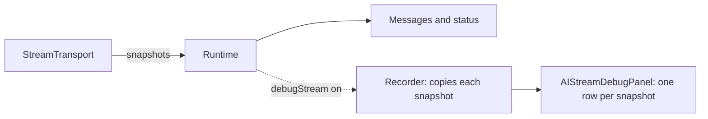

# Stream debug guide

> **Status:** experimental

The stream debug panel shows what your transport sent during each run: one row per snapshot, with the raw snapshot as formatted JSON. Use it while you build or fix a transport. Do not ship it to users.

It works with any transport. Your transport does not have to do anything for the panel to work.




## Turn it on

Pass `debugStream` to [`<AIProvider>`](./PROVIDER.md) and place `AIStreamDebugPanel` anywhere inside it:

```tsx
import {
  AIMessages,
  AIProvider,
  AIStreamDebugPanel,
  AIThread,
  AIThreadViewport,
  type AIRuntime,
} from '@vtex/shoreline-ai'

function Chat({ runtime }: { runtime: AIRuntime }) {
  return (
    <AIProvider runtime={runtime} debugStream>
      <AIThread>
        <AIThreadViewport>
          <AIMessages />
        </AIThreadViewport>
      </AIThread>
      <AIStreamDebugPanel />
    </AIProvider>
  )
}
```

| Prop of `<AIProvider>` | Default | Purpose |
|------------------------|---------|---------|
| `debugStream` | `false` | Records every run |
| `debugMaxRuns` | `20` | Runs kept. The oldest are dropped first |
| `debugMaxSteps` | `1000` | Steps kept per run. The oldest are dropped first |

When `debugStream` is off, nothing is recorded and the cost is zero. The panel then says that debug is off.

## What is a run and a step

- A **run** starts when the user sends a message and ends when the transport returns, fails or is cancelled. A run has an id (the id of the assistant message), the thread id, the id of the user message, the start and end times, its status and, if it failed, an error message.
- A **step** is one snapshot the transport yielded, or its final snapshot. Every snapshot is a step, even one that repeats the previous parts, so you see everything the transport sent.
- A step stores a copy of the snapshot exactly as the transport yielded it: its parts, its status and its `debug` data. The panel does not interpret it beyond listing the part types in the row title, so it keeps working if the parts change.

## Read the panel

1. Pick a run in the **Run** list. The newest run is first.
2. The details show the status, the ids, the times and the error message.
3. **Steps** lists the snapshots in the order they arrived. Each row shows its number, time, status and the types of the parts in the snapshot, in order (for example `reasoning, text`). The types are only read from `parts`, so a new part type is shown as it is. Open a row to see the raw snapshot as formatted JSON. **Copy JSON** copies the same text. If the transport sent reasoning first and then text, `parts` lists the reasoning first.
4. **Clear** removes every recorded run.

## Attach your own data

Add `debug` to a snapshot to see your raw payload inside the JSON of its step. The package never reads it.

```ts
const transport: StreamTransport = {
  async *run({ trigger }) {
    let parts: AIMessagePart[] = []

    for await (const event of callBackend(trigger.message)) {
      parts = event.parts
      yield { parts, status: 'streaming', debug: event.raw }
    }

    return { parts, status: 'ready' }
  },
}
```

## Good to know

- The recorder copies each snapshot with `structuredClone`. Values it cannot copy (functions, for example) are copied through JSON, and when that fails the value is kept as it is. The recorder never throws.
- You can turn `debugStream` on or off while the app runs. The thread, the thread id and the thread list are kept. Turning it off drops the recorded runs.
- A cancelled run is recorded with status `ready`, not `error`, and no error message.
- Records stay in memory and are lost on reload. An error in the recorder never breaks a run.
- Each provider records its own runs. A nested provider does not show the runs of its parent, see [PROVIDER.md](./PROVIDER.md#nested-and-sibling-providers).

## Build your own view

`useAIStreamDebug()` returns the records of the nearest provider:

```ts
const { enabled, runs, clear } = useAIStreamDebug()
```

| Field | Description |
|-------|-------------|
| `enabled` | `true` when the nearest provider has `debugStream` on |
| `runs` | `AIStreamDebugRun[]`, newest first. Empty when debug is off |
| `clear` | Removes every run |

```ts
interface AIStreamDebugRun {
  runId: string
  threadId: string
  userMessageId: string
  startedAt: string // ISO date
  endedAt?: string // not set while the run goes on
  status: StreamStatus
  error?: string
  steps: AIStreamDebugStep[]
}

interface AIStreamDebugStep {
  index: number // starts at 1
  at: string // ISO date
  status: StreamStatus | undefined
  snapshot: unknown // copy of the snapshot as the transport yielded it
}
```

`AIStreamDebugRunView` shows a single run: its details and its steps. `AIStreamDebugPanel` uses it for the selected run. Use it alone when you want your own run picker:

```tsx
import { AIStreamDebugRunView, useAIStreamDebug } from '@vtex/shoreline-ai'

function LastRun() {
  const { enabled, runs } = useAIStreamDebug()

  if (!enabled) return <p>Debug is off.</p>

  const [last] = runs

  return last ? <AIStreamDebugRunView run={last} /> : <p>No runs yet.</p>
}
```

| Component | Props |
|-----------|-------|
| `AIStreamDebugPanel` | `title` (default `'Stream debug'`) and `section` attributes |
| `AIStreamDebugRunView` | `run` (an item of `runs`) and `div` attributes |

Both use the styles from `@vtex/shoreline-ai/css` and the attributes `data-sl-ai-stream-debug*`.
