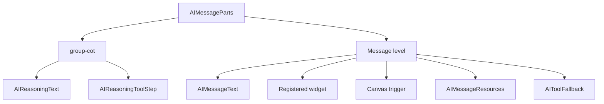
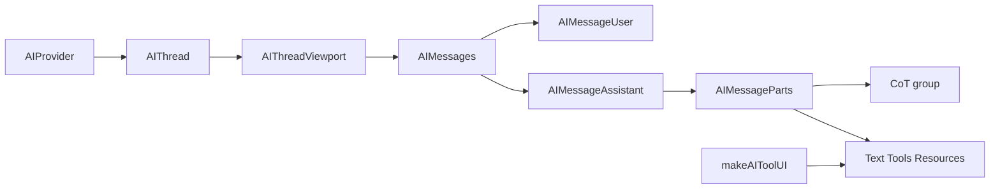

# Messages guide

> **Status:** experimental

Shoreline-styled message rendering for AI apps: the **`AIMessage*`** family from `@vtex/shoreline-ai` (user bubble, assistant Chain of Thought, markdown text, tool widgets, resource attachments, reasoning header, message actions). Mount inside `<AIProvider>`, usually inside `AIThreadViewport`. The viewport gives the list its padding through `--sl-ai-messages-padding`, also when the list sits inside your own wrapper (see [THREAD.md](./THREAD.md#layout-and-spacing)).

Related guides: [THREAD.md](./THREAD.md) (viewport layout), [PROVIDER.md](./PROVIDER.md), [HOOKS.md](./HOOKS.md) (message part hooks), [TOOL-UI.md](./TOOL-UI.md) (`makeAIToolUI`, canvas), [RUNTIME.md](./RUNTIME.md) (`AIMessage` / `AIMessagePart` model).

**Prerequisites:** `<AIProvider runtime={runtime}>` wrapping your chat UI. Import `@vtex/shoreline/css` and `@vtex/shoreline-ai/css`. Wrap with `LocaleProvider` so built-in labels use the `en-US` / `pt-BR` catalogs.

## Setup

```tsx
import '@vtex/shoreline/css'
import '@vtex/shoreline-ai/css'

import { LocaleProvider } from '@vtex/shoreline'
import {
  AIProvider,
  AIThread,
  AIThreadViewport,
  AIThreadEmpty,
  AIThreadViewportFooter,
  AIMessages,
} from '@vtex/shoreline-ai'
```

## Quick start

Normative tree: message list inside the thread viewport, between the empty slot and the sticky footer.

```tsx
<LocaleProvider locale="pt-BR">
  <AIProvider runtime={runtime}>
    <AIThread>
      <AIThreadViewport autoScroll>
        <AIThreadEmpty>{/* welcome */}</AIThreadEmpty>
        <AIMessages />
        <AIThreadViewportFooter>
          {/* scroll-to-bottom, composer, alerts */}
        </AIThreadViewportFooter>
      </AIThreadViewport>
    </AIThread>
  </AIProvider>
</LocaleProvider>
```

Drop-in usage requires no props — user and assistant layouts, CoT grouping, the reasoning header, markdown, tool routing and the actions bar are handled internally. The thread gives the list its spacing (see [THREAD.md](./THREAD.md#layout-and-spacing)).

The docs site has a page with live examples: `/components/ai-messages` (and `/components/ai-thread`).

## Message part model

Each message is an `AIMessage` with a `parts` array. Parts are typed as `AIMessagePart`:

| Type | Fields | Default rendering |
|------|--------|-------------------|
| `text` | `text` | `AIMessageText` → GFM markdown |
| `reasoning` | `text`, `status: 'streaming' \| 'complete'` | Reasoning panel (the `reasoning` template of `AIMessageParts`) → `AIReasoningText` |
| `tool` | `name`, `args`, `output`, `status`, `error?`, `metadata?` | Widget, canvas trigger, CoT step, or fallback |
| `resource` | `uri`, `name`, `mimeType` | Image preview or file row |

Full message shape and transport details: [RUNTIME.md](./RUNTIME.md). Read thread history via `useAIThread().messages`.

## Components

### List and layout

| Component | Purpose |
|-----------|---------|
| `AIMessages` | Full message list — drop-in with default user/assistant templates. Owns the `messages` catalog override and the `workingMark` shortcut |
| `AIMessageUser` | User message shell (right-aligned bubble) |
| `AIMessageAssistant` | Assistant message shell (left-aligned, CoT + tools). Without children it renders `AIMessageParts` and `AIMessageActions`; with children it renders exactly them |
| `AIMessageRoot` | Single-message container; sets `messageRole` |
| `AIMessageParts` | Part iteration, CoT grouping, optional custom renderer and `reasoning` template. Renders the pending reasoning header before the first part |

### Content

| Component | Purpose |
|-----------|---------|
| `AIMessageText` | Text part rendered as markdown |
| `AIMarkdown` | Standalone GFM markdown (no streaming cursor) |
| `AIReasoning` | Connected reasoning panel for the `reasoning` template of `AIMessageParts`. Reads status, duration and start time from the group. Only valid inside `AIMessageParts` |
| `useAIReasoning()` | Read-only `{ status, expanded, duration }` of the closest reasoning panel, for app parts placed inside it |
| `useAIMessage()` | `{ id, role, status, createdAt }` of the message you are inside (`status`: `running`, `complete` or `incomplete`). Key per-message app state, such as votes, by `id`. Re-renders only when one of these fields changes, not on every streamed token |
| `AIReasoningRoot` | Owns the panel state. Takes `status`, `duration`, `startedAt`, `defaultExpanded`, `expanded`, `onExpandedChange` |
| `AIReasoningHeader` | The 20px row: mark, label, elapsed time, chevron. Takes children to compose your own row |
| `AIReasoningMark` | The working mark, only while running |
| `AIReasoningLabel` | The status text ("Thinking…", "Thought for 1m 5s"). Shimmers while running |
| `AIReasoningElapsed` | Elapsed time while running ("42s", "1m 5s") |
| `AIReasoningTrigger` | The chevron button that opens and closes the panel. The only toggle in the header |
| `AIReasoningContent` | Collapsible body. Inside `AIReasoning` it renders the group's parts |
| `AIReasoningText` | Reasoning text inside CoT |
| `AIReasoningToolStep` | Compact step for unregistered tools in CoT |
| `AIThinkingIndicator` | The text loading effect: its children with a light band that sweeps across. No default text, no role |
| `AIWorkingMark` | The small spinning mark (16px box, 14px glyph). Decorative (`aria-hidden`) |
| `AIMessageActions` | Floating bar under a completed assistant message that has text. Without children: `AIMessageCopy` then `AIMessageDate`. With children: exactly them |
| `AIMessageAction` | A bar button (24px, 14px icon). `label` is its accessible name. Use it for thumbs or any app action |
| `AIMessageCopy` | Copies the text parts of the message. `onCopied` runs after a successful copy |
| `AIMessageDate` | When the message was sent ("now", "5m ago", "yesterday, 2:32 PM"). Reads `createdAt`, or takes `date` |
| `AIMessageResources` | Container for resource parts |
| `AIMessageResource` | Auto image or file chip |
| `AIMessageResourceImage` | Image preview variant |
| `AIMessageResourceFile` | File row variant |

### Helpers

| Export | Purpose |
|--------|---------|
| `renderDefaultParts(part, meta, options?)` | Built-in renderer — use as fallback in hybrid overrides |
| `defaultMessageGroupBy(part, ctx)` | The default grouping rule: reasoning and unregistered tools go to `group-cot`; everything else returns `null` (message level) |
| `AIMessagesI18nProvider` | Provides the messages catalog. `AIMessages` mounts it; mount it yourself to render or test message parts outside `AIMessages` |

## Composition variants

### Drop-in (default)

```tsx
<AIMessages />
```

Renders every message with built-in `AIMessageUser` and `AIMessageAssistant` presets. User messages appear as a right-aligned bubble; assistant messages show CoT, text, registered tools, and attachments.

### Explicit templates

Pass at most **one** `AIMessageUser` and **one** `AIMessageAssistant` as children. Duplicates throw at runtime.

```tsx
<AIMessages showReasoningTools={false}>
  <AIMessageUser />
  <AIMessageAssistant showReasoningTools={false} />
</AIMessages>
```

Use explicit templates when you need to wrap or change assistant content without reimplementing the message list. With children, `AIMessageAssistant` renders exactly what you pass: add `AIMessageParts` and `AIMessageActions` yourself.

### Custom part renderer

`AIMessageParts` accepts a function child `(part, meta) => ReactNode`. Return a node to replace default rendering for that part; return `null` or `undefined` to fall through to the built-in renderer.

```tsx
<AIMessages>
  <AIMessageAssistant>
    <AIMessageParts>
      {(part, meta) =>
        part.type === 'text' ? (
          <p data-app-custom-text>{part.text}</p>
        ) : null
      }
    </AIMessageParts>
  </AIMessageAssistant>
</AIMessages>
```

### Hybrid override (HITL or single tool)

Handle one part type locally; delegate everything else to `renderDefaultParts`:

```tsx
import { AIMessageParts, renderDefaultParts } from '@vtex/shoreline-ai'

<AIMessageParts>
  {(part, meta) => {
    if (part.type === 'tool' && part.name === 'hitl-approve') {
      return (
        <HitlWidget
          args={part.args}
          status={part.status}
          output={part.output}
          metadata={part.metadata}
        />
      )
    }
    return renderDefaultParts(part, meta)
  }}
</AIMessageParts>
```

Local overrides take precedence over globally registered `makeAIToolUI` components on the same surface.

### Hide CoT tool steps

Set `showReasoningTools={false}` on `AIMessages`, `AIMessageAssistant`, or `AIMessageParts`. Reasoning text still renders inside the CoT panel; compact tool steps for unregistered tools are omitted.

Registered widget and canvas tools always render at message level regardless of this flag.

### Explicit resource variants

For isolated rendering outside the automatic part flow, use explicit variants instead of a generic escape prop:

```tsx
<AIMessageResourceImage />
<AIMessageResourceFile />
```

Inside the default flow, `AIMessageResource` picks the variant from the current part scope.

### The working mark

`AIMessages` takes one reasoning-specific shortcut: `workingMark`. It is the glyph of every reasoning mark in the list, including the header shown before the first part, so an app with its own mark does not recompose the reasoning:

```tsx
<AIMessages workingMark={<IconSparkle />} />
```

Without it the mark is the My Assistant mark (the pink four-point star). There are three ways to override it: children of `AIWorkingMark`, children of `AIReasoningMark` (in a reasoning template), or `workingMark` on `AIMessages` for every mark in the list. Anything else about the reasoning goes through the template (next section).

### Reasoning

Each reasoning group is one 20px header row, with an optional body below it:

| State | Mark | Label | Time | Chevron |
|-------|------|-------|------|---------|
| Running | yes | "Thinking…" with the loading effect | elapsed: "40s", then "1m 5s" | yes |
| Done, with a duration | no | "Thought for 1m 5s" ("Thought for 40s" under a minute) | no | yes |
| Done, no duration | no | "Done thinking" | no | yes |

Only the chevron is a button. It has `aria-expanded` and `aria-controls`, and its accessible name is the label text (`aria-labelledby`). The open body is a `role="group"` named by the same label; with no label mounted it has no role. When no `AIReasoningLabel` is mounted in the header, the chevron gets an `aria-label` with the status text from the catalog instead. Clicking the label or the time does nothing.

The label, the elapsed time and the chevron icon use `--sl-fg-base-soft` (on hover the chevron gets the plain hover background and the `--sl-color-gray-9` color: darker on Horizon, the same gray as at rest on Sunrise, where `--sl-fg-base-soft` is already `--sl-color-gray-9`); a long label wraps and the row grows. The open body sits 8px below the header, with a 3px left bar and 16px of left padding; reasoning text is `caption-2` in the soft foreground color.

The running counter and the final duration share one format: seconds, minutes and seconds, then hours and minutes. It comes from `Intl.NumberFormat` (`unit` style, `narrow`) with the `LocaleProvider` locale, e.g. en-US "40s" and "1m 5s". pt-BR overrides the unit format in the built-in catalog to match the design ("40s", "1m 5s"; the `Intl` default would be "40 s", "1 min 5 s"). Any other locale gets the `Intl` format. While running, the header counts seconds itself; when the group completes it shows the runtime duration if there is one, otherwise the time it counted. A message loaded from history with no duration reads "Done thinking". The runtime does not stamp a duration on reasoning yet, so durations appear for groups that you watched run.

#### Before the first part

Every answer is assumed to have reasoning. While a message is running and has no text, reasoning or tool call yet, `AIMessageParts` renders the running header with no chevron: mark, "Thinking…" and the elapsed time. Only the label is a live region (`role="status"`), so screen readers announce "Thinking…" once and not every tick of the elapsed time. When the first reasoning part arrives it is the same header (the elapsed time does not reset, and the mark does not replay its enter animation: that group's root has `data-continued`) and the chevron appears. If that first group arrives already complete in the same update, its label keeps the time counted so far ("Thought for 8s") when the runtime gives no duration.

- If text arrives before any reasoning part, the pending header disappears. It never becomes a "complete" header with no body.
- If an unregistered tool call arrives first, it opens a running reasoning group: the header stays and now has a chevron.

Because the pending header belongs to `AIMessageParts`, it shows wherever you compose `AIMessageParts`, including inside custom `AIMessageAssistant` children.

#### The reasoning template

`AIMessageParts` takes a `reasoning` element: the template it renders once per reasoning group. The default is `<AIReasoning />`. Pass your own to rearrange or relabel the header; `AIReasoning` reads the group's status, duration, start time and parts from context, so it is only valid inside `AIMessageParts`.

```tsx
<AIMessageParts
  reasoning={
    <AIReasoning defaultExpanded>
      <AIReasoningHeader>
        <AIReasoningMark />
        <AIReasoningLabel>Analyzing orders…</AIReasoningLabel>
        <AIReasoningElapsed />
        <AIReasoningTrigger />
      </AIReasoningHeader>
      <AIReasoningContent />
    </AIReasoning>
  }
/>
```

Inside the template, `useAIReasoning()` gives your own parts read-only access to `{ status, expanded, duration }`.

#### Standalone reasoning compound

Build a panel by hand with `AIReasoningRoot`, outside the grouping rules. This is also how the show stories render each state:

```tsx
<AIReasoningRoot status="running" startedAt={startedAt}>
  <AIReasoningHeader />
  <AIReasoningContent>
    <AIReasoningText />
  </AIReasoningContent>
</AIReasoningRoot>
```

The parts must be used inside `AIReasoningRoot`. All message pieces read their labels from the messages catalog, so mount them under `AIMessages` or wrap them in `AIMessagesI18nProvider`. `AIReasoningText` reads the current reasoning part, so it only works where `AIMessageParts` renders a reasoning part.

For a controlled panel pass `expanded` and `onExpandedChange`; `defaultExpanded` is then ignored. Without `startedAt`, the root counts from its first render with `status="running"`.

### Thinking indicator and working mark

Both are primitives you can use anywhere, with no catalog and no message around them.

`AIThinkingIndicator` is the text loading effect and nothing else: a `span` whose children shimmer (light band in `--sl-color-gray-4` over `--sl-fg-base-soft` text, one sweep every 2.4 seconds). It has no dots, no default label and no `role`; set `role="status"` yourself when you need an announcement.

```tsx
<AIThinkingIndicator>Searching orders…</AIThinkingIndicator>
```

`AIWorkingMark` is the 14px spinning glyph in a 16px box, `aria-hidden`. The default glyph is the My Assistant mark; children replace it with the glyph of your app:

```tsx
<AIWorkingMark />
<AIWorkingMark><IconSparkle /></AIWorkingMark>
```

With `prefers-reduced-motion: reduce` the text effect is plain gray text and the mark pulses slowly instead of rotating.

### Actions bar

`AIMessageActions` is a 24px bar, the last block of a completed assistant message that has text: it sits in the flow, 12px below the block before it, and is always visible. It renders nothing while the message runs, for user messages, or for `incomplete` messages (a cancelled or failed run, or a message waiting for a tool result), so a partial answer cannot be copied. It also renders nothing for an answer nobody asked for, such as the opening text of a chat: an assistant message that does not come right after a user message. It has no boolean props.

- No children: `AIMessageCopy` and then `AIMessageDate`.
- With children: exactly the children, in that order. Include `AIMessageCopy` and `AIMessageDate` to keep them.

`AIMessageAssistant` renders `AIMessageActions` for you when it has no children. To put the bar elsewhere or to add actions, compose the assistant:

```tsx
type Vote = 'up' | 'down'

// Inside the bar, useAIMessage() gives the id of the answer the thumbs belong to.
function Thumbs(props: {
  votes: Record<string, Vote>
  onVote: (messageId: string, vote: Vote | null) => void
}) {
  const { id } = useAIMessage()
  const vote = props.votes[id]

  return (
    <>
      <AIMessageAction
        label="Good response"
        aria-pressed={vote === 'up'}
        onClick={() => props.onVote(id, vote === 'up' ? null : 'up')}
      >
        {/* the app's own icons; a filled glyph shows the pressed state */}
        {vote === 'up' ? <ThumbUpFilledIcon /> : <ThumbUpIcon />}
      </AIMessageAction>
      <AIMessageAction
        label="Bad response"
        aria-pressed={vote === 'down'}
        onClick={() => props.onVote(id, vote === 'down' ? null : 'down')}
      >
        {vote === 'down' ? <ThumbDownFilledIcon /> : <ThumbDownIcon />}
      </AIMessageAction>
    </>
  )
}

// votes: Record<string, Vote>, keyed by message id, owned by the app.
<AIMessages>
  <AIMessageAssistant>
    <AIMessageParts />
    <AIMessageActions>
      <Thumbs votes={votes} onVote={vote} />
      <AIMessageCopy onCopied={track} />
      <AIMessageDate />
    </AIMessageActions>
  </AIMessageAssistant>
</AIMessages>
```

Thumbs and their behavior belong to the app; the package ships neither. Use any Shoreline icon or your own SVG as the child of `AIMessageAction`. The pressed state is the app's: pass `aria-pressed` and swap the icon for a filled glyph, as the thumbs above do. `AIMessageAction` does not change the color of a pressed action; it keeps the resting `--sl-fg-base-soft`, also on hover. Bar icons rest at `--sl-fg-base-soft`. On hover the button gets the plain hover background and the icon `--sl-color-gray-9`, which is darker on Horizon and the same gray on Sunrise (there `--sl-fg-base-soft` is `--sl-color-gray-9`), so on Sunrise only the background changes. A disabled action does not react to hover.

`AIMessageCopy` writes the text parts of the message (joined by a blank line) to the clipboard. It shows Shoreline's copy icon; after a successful copy it shows the check icon for 2 seconds (`data-copied` is set), its accessible name becomes the `copied` string ("Copied!"), `onCopied` is called once, and a visually hidden live region announces `messageCopied`. No toast and no visible text is shown. If the clipboard is unavailable or rejects, nothing changes. An `onClick` that calls `event.preventDefault()` cancels the copy.

`AIMessageDate` is a `time` element with `dateTime` set to the ISO value and `title` set to the exact local date and time. It reads `createdAt` from the message, or takes a `date` prop, and renders nothing when there is no valid date. The text follows the locale of the `LocaleProvider` and comes from `Intl`: under a minute "now"; under an hour the elapsed minutes ("5m ago"); later on the same calendar day the time ("2:32 PM"); the previous calendar day "yesterday, 2:32 PM"; older dates the day, short month and time ("Nov 12, 2:32 PM"), with the year when it is not the current one ("Nov 12, 2025, 2:32 PM"). Days are local calendar days, not 24-hour spans. A locale can override a format in the built-in catalog where the `Intl` default does not match the design. Only pt-BR does: "há 5 min", "12 nov, 14:32" and "12 nov 2025, 14:32" (the `Intl` default would be "há 5 min." and "12 de nov., 14:32"). Any other locale gets the `Intl` format with no extra work. All dates share one clock that ticks once a minute while any date is mounted.

On the server and during hydration `AIMessageDate` renders only the `time` element with `dateTime`: no text, no `title`, no `data-just-now`. The relative text and the title appear after mount, in the viewer's locale and timezone, so server and client markup always match.

Only the "now" date is always visible. Any other date shows on hover or when focus is inside the message (so keyboard users reveal it with `Tab`). On `(hover: none)` devices it is always visible. Every button of the bar is reachable with `Tab`.

### Where a customization lives

| You want to change | Use |
|--------------------|-----|
| A text for the whole chat | `messages` on `AIMessages` |
| The text of one reasoning label | Children of `AIReasoningLabel` |
| The working mark | `workingMark` on `AIMessages` (or children of `AIReasoningMark`) |
| The header pieces or their order | The `reasoning` template of `AIMessageParts` |
| Bar actions | Children of `AIMessageActions` |
| Language, dates and durations | `LocaleProvider` |

### User bubble width

The bubble is plain CSS on `[data-sl-ai-message-role="user"] [data-sl-ai-message-content]`. Its maximum width is `--sl-ai-message-user-max-width` (default `33.75rem`).

### Static markdown

Use `AIMarkdown` outside the message stream for docs, previews, or non-streaming content:

```tsx
<AIMarkdown>{'# Hello\n\nParagraph with **bold**.'}</AIMarkdown>
```

## Chain of Thought and tool routing

Assistant parts are grouped automatically. Reasoning and unregistered tools belong to the CoT group; text, resources, and registered tools render at message level.



| Part | `makeAIToolUI` registration | `showReasoningTools` | Renders at |
|------|----------------------------|----------------------|------------|
| `reasoning` | — | — | CoT panel |
| `tool` (no UI) | none | `true` | CoT step |
| `tool` (no UI) | none | `false` | Omitted from CoT; fallback at message level |
| `tool` | `widget` | any | Message level (inline widget) |
| `tool` | `canvas` | any | Message level (trigger + `<AICanvas>`) |
| `text`, `resource` | — | — | Message level |

Register tools at app setup with `makeAIToolUI` — see [TOOL-UI.md](./TOOL-UI.md). Mount registered tool components once under `<AIProvider>`.

During streaming, adjacent CoT members coalesce into one collapse panel so reasoning and tool steps appear in arrival order.

## Accessing state

### Inside a custom renderer — `AIMessagePartMeta`

Every function child on `AIMessageParts` receives a second argument with derived context:

```ts
type AIMessagePartMeta = {
  index: number
  isStreaming: boolean
  placement: 'cot' | 'message'
  toolRegistration: AIToolRegistration | null
}
```

| Field | Use |
|-------|-----|
| `index` | 0-based position of the part in the message |
| `isStreaming` | `true` while the part is actively updating |
| `placement` | `'cot'` inside the reasoning panel; `'message'` at message level |
| `toolRegistration` | Registry entry when the part is a registered tool; otherwise `null` |

Prefer `meta.isStreaming` and `meta.placement` in custom renderers instead of subscribing to the full thread state.

### Message part hooks

Use inside `<AIProvider>`. Omit `messageId` when called inside an `AIMessage*` tree; pass `messageId` to read a specific message from elsewhere.

| Hook | Returns | When to use |
|------|---------|-------------|
| `useAIMessageParts(messageId?)` | `AIMessagePart[]` | Full normalized model — **preferred** |
| `useAIReasonings(messageId?)` | `AIReasoningPart[]` | Reasoning parts only |
| `useAITools(messageId?)` | `AIToolPart[]` | Tool parts only |
| `useAIResources(messageId?)` | `AIResourcePart[]` | Resource parts only: files the user attached and resources your transport yields |

Details and examples: [HOOKS.md](./HOOKS.md#message-hooks).

### Thread-level hooks

```ts
const { messages, loadMessages, sendMessage } = useAIThread()
const { isStreaming } = useAIStatus()
```

Example — sidebar preview of the last assistant reply:

```tsx
import { useAIThread, useAIMessageParts } from '@vtex/shoreline-ai'

function LastAssistantSummary() {
  const { messages } = useAIThread()
  const last = [...messages].reverse().find((m) => m.role === 'assistant')
  const parts = useAIMessageParts(last?.id)
  const text = parts.find((p) => p.type === 'text')?.text

  if (!text) return null

  return <p>{text.slice(0, 120)}…</p>
}
```

## Props reference

### `<AIMessages>`

| Prop | Default | Purpose |
|------|---------|---------|
| `showReasoningTools` | `true` | Compact tool steps inside CoT for unregistered tools |
| `messages` | — | Partial i18n override for the whole messages family |
| `workingMark` | the My Assistant mark | Glyph of every reasoning mark in the list that has no children of its own |
| `children` | — | Optional `AIMessageUser` + `AIMessageAssistant` templates |

Also accepts native `div` attributes.

### `<AIMessageAssistant>`

| Prop | Default | Purpose |
|------|---------|---------|
| `showReasoningTools` | `true` | Same as on `AIMessages` |
| `children` | `AIMessageParts` and `AIMessageActions` | With children it renders exactly them. Add `AIMessageParts` and `AIMessageActions` yourself |

### `<AIMessageParts>`

| Prop | Default | Purpose |
|------|---------|---------|
| `showReasoningTools` | `true` | Same as above |
| `reasoning` | `<AIReasoning />` | Element rendered once per reasoning group, and once as the running header before the first part |
| `children` | — | Optional `(part, meta) => ReactNode` renderer |

### `<AIReasoning>`

| Prop | Default | Purpose |
|------|---------|---------|
| `defaultExpanded` | `false` | Whether the panel starts open (uncontrolled) |
| `expanded` | — | Controlled expanded state |
| `onExpandedChange` | — | Called with the next state whenever the chevron is toggled |
| `children` | header and content | Panel parts |

### `<AIReasoningRoot>`

| Prop | Default | Purpose |
|------|---------|---------|
| `status` | `'complete'` | `'running'` or `'complete'`. Drives the label, the mark, the elapsed time and the `data-status` attribute |
| `duration` | — | Time spent reasoning, in milliseconds. When omitted, the time counted from `startedAt` is used |
| `startedAt` | first render with `status="running"` | When the reasoning started, in epoch milliseconds. Origin of the elapsed time |
| `defaultExpanded` | `false` | Whether the panel starts open (uncontrolled) |
| `expanded` | — | Controlled expanded state. `defaultExpanded` is ignored when set |
| `onExpandedChange` | — | Called with the next state whenever the chevron is toggled |

### `<AIReasoningHeader>`, `Mark`, `Label`

| Component | Prop | Default | Purpose |
|-----------|------|---------|---------|
| `AIReasoningHeader` | `children` | mark, label, elapsed time, trigger | Header parts |
| `AIReasoningMark` | `children` | `workingMark` from `AIMessages`, then the My Assistant mark | Custom glyph |
| `AIReasoningLabel` | `children` | the localized status text | Custom label text |

`AIReasoningElapsed` and `AIReasoningTrigger` have no props of their own: the trigger takes native `button` attributes and its accessible name comes from the label.

### `<AIThinkingIndicator>` and `<AIWorkingMark>`

| Component | Prop | Purpose |
|-----------|------|---------|
| `AIThinkingIndicator` | `children` | The text that shimmers. Nothing is rendered by default |
| `AIWorkingMark` | `children` | The glyph that spins. Default is the My Assistant mark |

Both accept native `span` attributes.

### `<AIMessageActions>`

| Prop | Default | Purpose |
|------|---------|---------|
| `children` | `AIMessageCopy` and `AIMessageDate` | The actions of the bar. They replace the default ones |

### `<AIMessageAction>`

| Prop | Purpose |
|------|---------|
| `label` | Required. Accessible name of the button |
| `children` | Required. The content, usually an icon |

Also accepts native `button` attributes (`aria-pressed`, `onClick`, …).

### `<AIMessageCopy>`

| Prop | Purpose |
|------|---------|
| `onCopied` | Called once after the message text is copied successfully |

Also accepts native `button` attributes (`onClick` runs before the copy).

### `<AIMessageDate>`

| Prop | Default | Purpose |
|------|---------|---------|
| `date` | `createdAt` of the message | `Date \| string \| number` to show instead |

Also accepts native `time` attributes.

### `<AIMarkdown>`

| Prop | Purpose |
|------|---------|
| `children` | Markdown source string |

`AIMessageUser`, `AIMessageRoot`, `AIMessageText`, and resource components accept standard `div` HTML attributes. `AIReasoningToolStep` requires a `part: AIToolPart` prop when used standalone.

## i18n

Built-in locales: `en-US`, `pt-BR`.

| Message id | Default (`en-US`) | Default (`pt-BR`) | Used by |
|------------|-------------------|-------------------|---------|
| `reasoningStreaming` | Thinking… | Pensando… | Reasoning label while running |
| `reasoningDone` | Done thinking | Pensamento concluído | Label when complete with no duration |
| `reasoningDoneIn` | Thought for {duration} | Pensou por {duration} | Label when complete with a duration (`{duration}` comes from `Intl`) |
| `copyMessage` | Copy message | Copiar mensagem | `AIMessageCopy` accessible name |
| `copied` | Copied! | Copiado! | `AIMessageCopy` accessible name for 2 seconds after a copy |
| `messageCopied` | Message copied | Mensagem copiada | Live-region announcement after a copy |
| `copyCode` | Copy code | Copiar código | Not used yet; reserved for code blocks (markdown follow-up) |

Override only on the root:

```tsx
<AIMessages messages={{ reasoningDone: 'Finished reasoning' }} />
```

Unset keys fall back to the active `LocaleProvider` catalog. The text of a single label can instead be set with children of `AIReasoningLabel`.

## Styling hooks

Import package CSS once:

```tsx
import '@vtex/shoreline-ai/css'
```

Stable `data-sl-*` hooks for app overrides. Use only `--sl-*` tokens inside `@layer sl-components`.

| Attribute | Region |
|-----------|--------|
| `[data-sl-ai-messages]` | Message list |
| `[data-sl-ai-message]` | Message row. Uses `content-visibility: auto` (see below). Do not override its `padding` or `margin` |
| `[data-sl-ai-message][data-sl-ai-message-role="user"]` | User message — right-aligned |
| `[data-sl-ai-message][data-sl-ai-message-role="assistant"]` | Assistant message — left-aligned |
| `[data-sl-ai-message-content]` | Message content wrapper |
| `[data-sl-ai-message-parts]` | Parts container |
| `[data-sl-ai-reasoning]` | CoT panel. Has `data-status="running" \| "complete"`, and `data-continued` on the group that took over from the pending header |
| `[data-sl-ai-reasoning-header]` | The 20px header row |
| `[data-sl-ai-reasoning-mark]` | The working mark (running only) |
| `[data-sl-ai-reasoning-label]` | The status text |
| `[data-sl-ai-reasoning-elapsed]` | The elapsed time (running only) |
| `[data-sl-ai-reasoning-trigger]` | The chevron button. Has `aria-expanded` |
| `[data-sl-ai-reasoning-content]` | CoT body (left border) |
| `[data-sl-ai-reasoning-text]` | One reasoning step |
| `[data-sl-ai-reasoning-tool-step]` | Compact tool step in CoT |
| `[data-sl-ai-message-text]` | Text part |
| `[data-sl-ai-markdown]` | Markdown output |
| `[data-sl-ai-thinking-indicator]` | The text loading effect |
| `[data-sl-ai-working-mark]` | The working mark. Its glyph is `[data-sl-ai-working-mark-glyph]` |
| `[data-sl-ai-message-actions]` | The bar that closes a completed assistant message |
| `[data-sl-ai-message-action]` | A bar button. Styled for `:hover` and `:focus-visible`; with `aria-pressed="true"` it keeps its resting color (the app swaps the icon) |
| `[data-sl-ai-message-copy]` | The copy button (also an action). Has `data-copied` for 2 seconds after a copy |
| `[data-sl-ai-message-date]` | The date. Has `data-just-now` under a minute, when it is always visible |
| `[data-sl-ai-message-copy-status]` | Live region with the `messageCopied` announcement |
| `[data-sl-ai-message-resources]` | Resource attachments row |
| `[data-sl-ai-message-resource]` | Single attachment chip |
| `[data-sl-ai-message-resource-image]` | Image preview |
| `[data-sl-ai-message-resource-icon]` | File icon |
| `[data-sl-ai-message-resource-info]` | File name and mime type |

User bubble styling is applied via CSS on `[data-sl-ai-message-role="user"] [data-sl-ai-message-content]` — no dedicated bubble component.

| CSS variable | Default | Purpose |
|--------------|---------|---------|
| `--sl-ai-message-user-max-width` | `33.75rem` | Maximum width of the user bubble |
| `--sl-ai-message-intrinsic-size` | `5rem` | Placeholder height of a message row that was not rendered yet |
| `--sl-ai-messages-gap` | `var(--sl-space-3)` | Gap between messages, and the space below the last one (see [THREAD.md](./THREAD.md#layout-and-spacing)) |
| `--sl-ai-thread-padding-inline` | `var(--sl-space-6)` | Padding on the sides of the messages inside `AIThreadViewport` |
| `--sl-ai-thread-padding-block` | `var(--sl-space-4)` | Padding above and below the messages inside `AIThreadViewport` |
| `--sl-ai-thread-padding` | not set | Shortcut that sets both axes at once |
| `--sl-ai-messages-padding` | `0`; inside `AIThreadViewport`, the thread padding | Padding of `[data-sl-ai-messages]`. The viewport sets it and it is inherited, so a wrapper around `AIMessages` keeps the spacing; set it to `0` on a wrapper that pads itself |

### `content-visibility`

Every `[data-sl-ai-message]` uses `content-visibility: auto` and `contain-intrinsic-block-size: auto var(--sl-ai-message-intrinsic-size, 5rem)`, so off-screen rows skip layout and paint in long threads. Because this clips painting to the row box, the row has padding and a negative margin that cancels it, and `box-sizing: content-box`, so focus rings, such as the ones of the reasoning chevron and of the actions bar, are not cut off. The content keeps the same width and position as without the padding, but the row box itself extends by `--sl-space-4` on each side of the messages container. A focus ring at the very edge of the container is therefore still clipped by an ancestor with `overflow: hidden`, such as `AIThreadViewport`. The default thread spacing covers this: `AIThreadViewport` gives the list `1.5rem` of side padding through `--sl-ai-messages-padding`, which is inherited, so it also applies when your app wraps `AIMessages` in its own element. A wrapper that pads itself sets `--sl-ai-messages-padding: 0` so the padding is not applied twice. See [THREAD.md](./THREAD.md#wrapping-aimessages). Consumers must not override `padding`, `margin` or `box-sizing` on `[data-sl-ai-message]`. Heights of rows that were never on screen are estimates, so the scroll bar can shift slightly in long histories.

## Best practices

### Composition

- Start with `<AIMessages />` and add explicit templates only when layout requirements grow.
- Override individual parts via `AIMessageParts` function children — do not reimplement the full message list or CoT grouping.
- Prefer explicit variants (`AIMessageResourceImage`, `AIMessageResourceFile`) over generic props when rendering resources in isolation.
- Local `AIMessageParts` overrides win over global `makeAIToolUI` on the same surface.

### Performance

- In custom renderers, read `meta.isStreaming` and `meta.placement` instead of subscribing to the entire thread.
- When building custom hooks, avoid selectors that return new object references on every render — subscribe to simple values (strings, numbers, booleans) separately.
- Import from `@vtex/shoreline-ai` barrel exports; avoid deep package paths.
- Return `null` early for parts you do not customize; call `renderDefaultParts` for the rest.

### Shoreline

- Import `@vtex/shoreline/css` and `@vtex/shoreline-ai/css` once at the app root.
- Style overrides through `data-sl-*` selectors and `--sl-*` tokens.
- Keep `LocaleProvider` above the chat tree for localized labels.

### Anti-patterns

| Avoid | Prefer |
|-------|--------|
| Duplicating CoT grouping logic | Default grouping via `AIMessageParts`. `defaultMessageGroupBy` is exported for reading the rule, but `AIMessageParts` has no `groupBy` prop |
| Replacing `AIMessageText` with a controlled local textarea for streaming | `AIMessageParts` override that reads `meta.isStreaming` |
| Styling user bubbles with ad hoc classes | `[data-sl-ai-message-role="user"]` + tokens, or `--sl-ai-message-user-max-width` |
| Overriding `padding` / `margin` on `[data-sl-ai-message]` | Leave them; they keep focus rings from being clipped |

## Integration overview



Mount `<AICanvas />` alongside the thread when using canvas-mode tools. Thread layout details: [THREAD.md](./THREAD.md).
