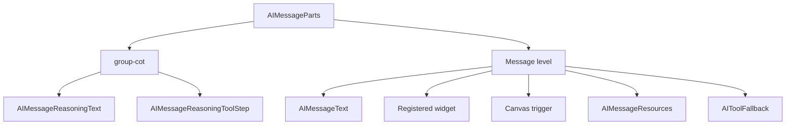
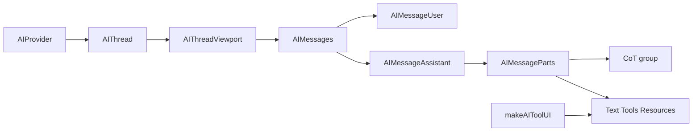

# Messages guide

> **Status:** experimental

Shoreline-styled message rendering for AI apps: the **`AIMessage*`** family from `@vtex/shoreline-ai` (user bubble, assistant Chain of Thought, markdown text, tool widgets, resource attachments, reasoning header, message actions). Mount inside `<AIProvider>` and typically as a direct child of `AIThreadViewport`: the thread pads the list only in that position (see [THREAD.md](./THREAD.md#layout-and-spacing)).

Related guides: [THREAD.md](./THREAD.md) (viewport layout), [PROVIDER.md](./PROVIDER.md), [HOOKS.md](./HOOKS.md) (message part hooks), [TOOL-UI.md](./TOOL-UI.md) (`makeAIToolUI`, canvas), [RUNTIME.md](./RUNTIME.md) (`AIMessage` / `AIMessagePart` model).

**Prerequisites:** `<AIProvider runtime={runtime}>` wrapping your chat UI. Import `@vtex/shoreline/css` and `@vtex/shoreline-ai/css`. Wrap with `LocaleProvider` so built-in labels use the `en-US` / `pt-BR` catalogs.

## Setup

```tsx
import '@vtex/shoreline/css'
import '@vtex/shoreline-ai/css'

import { LocaleProvider } from '@vtex/shoreline'
import {
  AIProvider,
  AIThread,
  AIThreadViewport,
  AIThreadEmpty,
  AIThreadViewportFooter,
  AIMessages,
} from '@vtex/shoreline-ai'
```

## Quick start

Normative tree: message list inside the thread viewport, between the empty slot and the sticky footer.

```tsx
<LocaleProvider locale="pt-BR">
  <AIProvider runtime={runtime}>
    <AIThread>
      <AIThreadViewport autoScroll>
        <AIThreadEmpty>{/* welcome */}</AIThreadEmpty>
        <AIMessages />
        <AIThreadViewportFooter>
          {/* scroll-to-bottom, composer, alerts */}
        </AIThreadViewportFooter>
      </AIThreadViewport>
    </AIThread>
  </AIProvider>
</LocaleProvider>
```

Drop-in usage requires no props — user and assistant layouts, CoT grouping, the reasoning header, markdown, tool routing and the actions bar are handled internally. The thread gives the list its spacing (see [THREAD.md](./THREAD.md#layout-and-spacing)).

The docs site has a page with live examples: `/components/ai-messages` (and `/components/ai-thread`).

## Message part model

Each message is an `AIMessage` with a `parts` array. Parts are typed as `AIMessagePart`:

| Type | Fields | Default rendering |
|------|--------|-------------------|
| `text` | `text` | `AIMessageText` → GFM markdown |
| `reasoning` | `text`, `status: 'streaming' \| 'complete'` | Reasoning panel (the `reasoning` template of `AIMessageParts`) → `AIMessageReasoningText` |
| `tool` | `name`, `args`, `output`, `status`, `error?`, `metadata?` | Widget, canvas trigger, CoT step, or fallback |
| `resource` | `uri`, `name`, `mimeType` | Image preview or file row |

Full message shape and transport details: [RUNTIME.md](./RUNTIME.md). Read thread history via `useAIThread().messages`.

## Components

### List and layout

| Component | Purpose |
|-----------|---------|
| `AIMessages` | Full message list — drop-in with default user/assistant templates. Owns the `messages` catalog override and the `workingMark` shortcut |
| `AIMessageUser` | User message shell (right-aligned bubble) |
| `AIMessageAssistant` | Assistant message shell (left-aligned, CoT + tools). Without children it renders `AIMessageParts` and `AIMessageActions`; with children it renders exactly them |
| `AIMessageRoot` | Single-message container; sets `messageRole` |
| `AIMessageParts` | Part iteration, CoT grouping, optional custom renderer and `reasoning` template. Renders the pending reasoning header before the first part |

### Content

| Component | Purpose |
|-----------|---------|
| `AIMessageText` | Text part rendered as markdown |
| `AIMarkdown` | Standalone GFM markdown (no streaming cursor) |
| `AIMessageReasoning` | Connected reasoning panel for the `reasoning` template of `AIMessageParts`. Reads status, duration and start time from the group. Only valid inside `AIMessageParts` |
| `useAIMessageReasoning()` | Read-only `{ status, expanded, duration }` of the closest reasoning panel, for app parts placed inside it |
| `AIMessageReasoningRoot` | Owns the panel state. Takes `status`, `duration`, `startedAt`, `defaultExpanded`, `expanded`, `onExpandedChange` |
| `AIMessageReasoningHeader` | The 20px row: mark, label, elapsed time, chevron. Takes children to compose your own row |
| `AIMessageReasoningMark` | The working mark, only while running |
| `AIMessageReasoningLabel` | The status text ("Reasoning…", "Reasoning completed in 2m"). Shimmers while running |
| `AIMessageReasoningElapsed` | Elapsed time while running ("42s", "1m 5s") |
| `AIMessageReasoningTrigger` | The chevron button that opens and closes the panel. The only toggle in the header |
| `AIMessageReasoningContent` | Collapsible body. Inside `AIMessageReasoning` it renders the group's parts |
| `AIMessageReasoningText` | Reasoning text inside CoT |
| `AIMessageReasoningToolStep` | Compact step for unregistered tools in CoT |
| `AIThinkingIndicator` | The text loading effect: its children with a light band that sweeps across. No default text, no role |
| `AIWorkingMark` | The small spinning mark (16px box, 14px glyph). Decorative (`aria-hidden`) |
| `AIMessageActions` | Floating bar under a completed assistant message that has text. Without children: `AIMessageCopy` then `AIMessageDate`. With children: exactly them |
| `AIMessageAction` | A bar button (20px, 14px icon). `label` is its accessible name. Use it for thumbs or any app action |
| `AIMessageCopy` | Copies the text parts of the message. `onCopied` runs after a successful copy |
| `AIMessageDate` | Relative date of the message ("now", "5m ago"). Reads `createdAt`, or takes `date` |
| `AIMessageResources` | Container for resource parts |
| `AIMessageResource` | Auto image or file chip |
| `AIMessageResourceImage` | Image preview variant |
| `AIMessageResourceFile` | File row variant |

### Helpers

| Export | Purpose |
|--------|---------|
| `renderDefaultParts(part, meta, options?)` | Built-in renderer — use as fallback in hybrid overrides |
| `defaultMessageGroupBy(part, ctx)` | The default grouping rule: reasoning and unregistered tools go to `group-cot`; everything else returns `null` (message level) |
| `MessageMessagesProvider` | Provides the messages catalog. `AIMessages` mounts it; mount it yourself to render or test message parts outside `AIMessages` |

## Composition variants

### Drop-in (default)

```tsx
<AIMessages />
```

Renders every message with built-in `AIMessageUser` and `AIMessageAssistant` presets. User messages appear as a right-aligned bubble; assistant messages show CoT, text, registered tools, and attachments.

### Explicit templates

Pass at most **one** `AIMessageUser` and **one** `AIMessageAssistant` as children. Duplicates throw at runtime.

```tsx
<AIMessages showReasoningTools={false}>
  <AIMessageUser />
  <AIMessageAssistant showReasoningTools={false} />
</AIMessages>
```

Use explicit templates when you need to wrap or change assistant content without reimplementing the message list. With children, `AIMessageAssistant` renders exactly what you pass: add `AIMessageParts` and `AIMessageActions` yourself.

### Custom part renderer

`AIMessageParts` accepts a function child `(part, meta) => ReactNode`. Return a node to replace default rendering for that part; return `null` or `undefined` to fall through to the built-in renderer.

```tsx
<AIMessages>
  <AIMessageAssistant>
    <AIMessageParts>
      {(part, meta) =>
        part.type === 'text' ? (
          <p data-app-custom-text>{part.text}</p>
        ) : null
      }
    </AIMessageParts>
  </AIMessageAssistant>
</AIMessages>
```

### Hybrid override (HITL or single tool)

Handle one part type locally; delegate everything else to `renderDefaultParts`:

```tsx
import { AIMessageParts, renderDefaultParts } from '@vtex/shoreline-ai'

<AIMessageParts>
  {(part, meta) => {
    if (part.type === 'tool' && part.name === 'hitl-approve') {
      return (
        <HitlWidget
          args={part.args}
          status={part.status}
          output={part.output}
          metadata={part.metadata}
        />
      )
    }
    return renderDefaultParts(part, meta)
  }}
</AIMessageParts>
```

Local overrides take precedence over globally registered `makeAIToolUI` components on the same surface.

### Hide CoT tool steps

Set `showReasoningTools={false}` on `AIMessages`, `AIMessageAssistant`, or `AIMessageParts`. Reasoning text still renders inside the CoT panel; compact tool steps for unregistered tools are omitted.

Registered widget and canvas tools always render at message level regardless of this flag.

### Explicit resource variants

For isolated rendering outside the automatic part flow, use explicit variants instead of a generic escape prop:

```tsx
<AIMessageResourceImage />
<AIMessageResourceFile />
```

Inside the default flow, `AIMessageResource` picks the variant from the current part scope.

### The working mark

`AIMessages` takes one reasoning-specific shortcut: `workingMark`. It is the glyph of every reasoning mark in the list, including the header shown before the first part, so an app with its own mark does not recompose the reasoning:

```tsx
<AIMessages workingMark={<MyAssistantMark />} />
```

Without it the mark is a neutral four-point spark. Anything else about the reasoning goes through the template (next section).

### Reasoning

Each reasoning group is one 20px header row, with an optional body below it:

| State | Mark | Label | Time | Chevron |
|-------|------|-------|------|---------|
| Running | yes | "Reasoning…" with the loading effect | elapsed: "40s", then "1m 5s" | yes |
| Done, with a duration | no | "Reasoning completed in 2m" ("in 40s" under a minute) | no | yes |
| Done, no duration | no | "Reasoning complete" | no | yes |

Only the chevron is a button. It has `aria-expanded` and `aria-controls`, and its accessible name is the label text (`aria-labelledby`). When no `AIMessageReasoningLabel` is mounted in the header, the chevron gets an `aria-label` with the status text from the catalog instead. Clicking the label or the time does nothing.

The open body sits 8px below the header, with a 3px left bar and 16px of left padding; reasoning text is `caption-2` in the soft foreground color.

Times and durations come from `Intl.NumberFormat` (`unit` style, `narrow`) with the `LocaleProvider` locale: en-US "40s" and "1m 5s", pt-BR "40 s" and "1 min 5 s". While running, the header counts seconds itself; when the group completes it shows the runtime duration if there is one, otherwise the time it counted. A message loaded from history with no duration reads "Reasoning complete". The runtime does not stamp a duration on reasoning yet, so durations appear for groups that you watched run.

#### Before the first part

Every answer is assumed to have reasoning. While a message is running and has no text, reasoning or tool call yet, `AIMessageParts` renders the running header with no chevron and `role="status"`: mark, "Reasoning…" and the elapsed time. When the first reasoning part arrives it is the same header (the elapsed time does not reset) and the chevron appears.

- If text arrives before any reasoning part, the pending header disappears. It never becomes a "complete" header with no body.
- If an unregistered tool call arrives first, it opens a running reasoning group: the header stays and now has a chevron.

Because the pending header belongs to `AIMessageParts`, it shows wherever you compose `AIMessageParts`, including inside custom `AIMessageAssistant` children.

#### The reasoning template

`AIMessageParts` takes a `reasoning` element: the template it renders once per reasoning group. The default is `<AIMessageReasoning />`. Pass your own to rearrange or relabel the header; `AIMessageReasoning` reads the group's status, duration, start time and parts from context, so it is only valid inside `AIMessageParts`.

```tsx
<AIMessageParts
  reasoning={
    <AIMessageReasoning defaultExpanded>
      <AIMessageReasoningHeader>
        <AIMessageReasoningMark />
        <AIMessageReasoningLabel>Analyzing orders…</AIMessageReasoningLabel>
        <AIMessageReasoningElapsed />
        <AIMessageReasoningTrigger />
      </AIMessageReasoningHeader>
      <AIMessageReasoningContent />
    </AIMessageReasoning>
  }
/>
```

Inside the template, `useAIMessageReasoning()` gives your own parts read-only access to `{ status, expanded, duration }`.

#### Standalone reasoning compound

Build a panel by hand with `AIMessageReasoningRoot`, outside the grouping rules. This is also how the show stories render each state:

```tsx
<AIMessageReasoningRoot status="running" startedAt={startedAt}>
  <AIMessageReasoningHeader />
  <AIMessageReasoningContent>
    <AIMessageReasoningText />
  </AIMessageReasoningContent>
</AIMessageReasoningRoot>
```

The parts must be used inside `AIMessageReasoningRoot`. All message pieces read their labels from the messages catalog, so mount them under `AIMessages` or wrap them in `MessageMessagesProvider`. `AIMessageReasoningText` reads the current reasoning part, so it only works where `AIMessageParts` renders a reasoning part.

For a controlled panel pass `expanded` and `onExpandedChange`; `defaultExpanded` is then ignored. Without `startedAt`, the root counts from its first render with `status="running"`.

### Thinking indicator and working mark

Both are primitives you can use anywhere, with no catalog and no message around them.

`AIThinkingIndicator` is the text loading effect and nothing else: a `span` whose children shimmer (light band in `--sl-color-gray-4` over `--sl-color-gray-8` text, one sweep every 2.4 seconds). It has no dots, no default label and no `role`; set `role="status"` yourself when you need an announcement.

```tsx
<AIThinkingIndicator>Searching orders…</AIThinkingIndicator>
```

`AIWorkingMark` is the 14px spinning glyph in a 16px box, `aria-hidden`. Children replace the default glyph:

```tsx
<AIWorkingMark />
<AIWorkingMark><MyAssistantGlyph /></AIWorkingMark>
```

With `prefers-reduced-motion: reduce` the text effect is plain gray text and the mark pulses slowly instead of rotating.

### Actions bar

`AIMessageActions` is a 20px bar that floats 4px below a completed assistant message that has text. It takes no height, is always visible, and renders nothing while the message runs, for user messages, or for `incomplete` messages (a cancelled run), so a partial answer cannot be copied. It has no boolean props.

- No children: `AIMessageCopy` and then `AIMessageDate`.
- With children: exactly the children, in that order. Include `AIMessageCopy` and `AIMessageDate` to keep them.

`AIMessageAssistant` renders `AIMessageActions` for you when it has no children. To put the bar elsewhere or to add actions, compose the assistant:

```tsx
<AIMessages>
  <AIMessageAssistant>
    <AIMessageParts />
    <AIMessageActions>
      <AIMessageAction label="Good response" aria-pressed={liked} onClick={like}>
        <ThumbUpIcon />   {/* the app's own icon */}
      </AIMessageAction>
      <AIMessageAction label="Bad response" onClick={dislike}>
        <ThumbDownIcon />
      </AIMessageAction>
      <AIMessageCopy onCopied={track} />
      <AIMessageDate />
    </AIMessageActions>
  </AIMessageAssistant>
</AIMessages>
```

Thumbs and their behavior belong to the app; the package ships neither. Use any Shoreline icon or your own SVG as the child of `AIMessageAction`. `AIMessageAction` sets `aria-pressed` styling (the pressed color is `--sl-fg-base-soft`).

`AIMessageCopy` writes the text parts of the message (joined by a blank line) to the clipboard. It shows Shoreline's copy icon; after a successful copy it shows the check icon for 2 seconds (`data-copied` is set), its accessible name becomes the `copied` string ("Copied!"), `onCopied` is called once, and a visually hidden live region announces `messageCopied`. No toast and no visible text is shown. If the clipboard is unavailable or rejects, nothing changes.

`AIMessageDate` is a `time` element with `dateTime` set to the ISO value and `title` set to the exact local date and time. It reads `createdAt` from the message, or takes a `date` prop, and renders nothing when there is no valid date. The text is relative and localized with `Intl.RelativeTimeFormat` (`narrow`, `numeric: 'auto'`): en-US "now", "1m ago", "2h ago", "yesterday", "4d ago"; pt-BR "agora", "há 1 min.", "há 2 h", "ontem", "há 4 dias". Under one minute it reads "now". One month and one year read as `Intl` gives them ("last mo.", "last yr." in en-US). All dates share one clock that ticks once a minute while any date is mounted.

Only the "now" date is always visible. Any other date shows on hover or when focus is inside the message (so keyboard users reveal it with `Tab`). On `(hover: none)` devices it is always visible. Every button of the bar is reachable with `Tab`.

### Where a customization lives

| You want to change | Use |
|--------------------|-----|
| A text for the whole chat | `messages` on `AIMessages` |
| The text of one reasoning label | Children of `AIMessageReasoningLabel` |
| The working mark | `workingMark` on `AIMessages` (or children of `AIMessageReasoningMark`) |
| The header pieces or their order | The `reasoning` template of `AIMessageParts` |
| Bar actions | Children of `AIMessageActions` |
| Language, dates and durations | `LocaleProvider` |

### User bubble width

The bubble is plain CSS on `[data-sl-ai-message-role="user"] [data-sl-ai-message-content]`. Its maximum width is `--sl-ai-message-user-max-width` (default `33.75rem`).

### Static markdown

Use `AIMarkdown` outside the message stream for docs, previews, or non-streaming content:

```tsx
<AIMarkdown>{'# Hello\n\nParagraph with **bold**.'}</AIMarkdown>
```

## Chain of Thought and tool routing

Assistant parts are grouped automatically. Reasoning and unregistered tools belong to the CoT group; text, resources, and registered tools render at message level.



| Part | `makeAIToolUI` registration | `showReasoningTools` | Renders at |
|------|----------------------------|----------------------|------------|
| `reasoning` | — | — | CoT panel |
| `tool` (no UI) | none | `true` | CoT step |
| `tool` (no UI) | none | `false` | Omitted from CoT; fallback at message level |
| `tool` | `widget` | any | Message level (inline widget) |
| `tool` | `canvas` | any | Message level (trigger + `<AICanvas>`) |
| `text`, `resource` | — | — | Message level |

Register tools at app setup with `makeAIToolUI` — see [TOOL-UI.md](./TOOL-UI.md). Mount registered tool components once under `<AIProvider>`.

During streaming, adjacent CoT members coalesce into one collapse panel so reasoning and tool steps appear in arrival order.

## Accessing state

### Inside a custom renderer — `AIMessagePartMeta`

Every function child on `AIMessageParts` receives a second argument with derived context:

```ts
type AIMessagePartMeta = {
  index: number
  isStreaming: boolean
  placement: 'cot' | 'message'
  toolRegistration: AIToolRegistration | null
}
```

| Field | Use |
|-------|-----|
| `index` | 0-based position of the part in the message |
| `isStreaming` | `true` while the part is actively updating |
| `placement` | `'cot'` inside the reasoning panel; `'message'` at message level |
| `toolRegistration` | Registry entry when the part is a registered tool; otherwise `null` |

Prefer `meta.isStreaming` and `meta.placement` in custom renderers instead of subscribing to the full thread state.

### Message part hooks

Use inside `<AIProvider>`. Omit `messageId` when called inside an `AIMessage*` tree; pass `messageId` to read a specific message from elsewhere.

| Hook | Returns | When to use |
|------|---------|-------------|
| `useAIMessageParts(messageId?)` | `AIMessagePart[]` | Full normalized model — **preferred** |
| `useAIReasonings(messageId?)` | `AIReasoningPart[]` | Reasoning parts only |
| `useAITools(messageId?)` | `AIToolPart[]` | Tool parts only |
| `useAIResources(messageId?)` | `AIResourcePart[]` | Resource parts only: files the user attached and resources your transport yields |

Details and examples: [HOOKS.md](./HOOKS.md#message-hooks).

### Thread-level hooks

```ts
const { messages, loadMessages, sendMessage } = useAIThread()
const { isStreaming } = useAIStatus()
```

Example — sidebar preview of the last assistant reply:

```tsx
import { useAIThread, useAIMessageParts } from '@vtex/shoreline-ai'

function LastAssistantSummary() {
  const { messages } = useAIThread()
  const last = [...messages].reverse().find((m) => m.role === 'assistant')
  const parts = useAIMessageParts(last?.id)
  const text = parts.find((p) => p.type === 'text')?.text

  if (!text) return null

  return <p>{text.slice(0, 120)}…</p>
}
```

## Props reference

### `<AIMessages>`

| Prop | Default | Purpose |
|------|---------|---------|
| `showReasoningTools` | `true` | Compact tool steps inside CoT for unregistered tools |
| `messages` | — | Partial i18n override for the whole messages family |
| `workingMark` | a four-point spark | Glyph of every reasoning mark in the list that has no children of its own |
| `children` | — | Optional `AIMessageUser` + `AIMessageAssistant` templates |

Also accepts native `div` attributes.

### `<AIMessageAssistant>`

| Prop | Default | Purpose |
|------|---------|---------|
| `showReasoningTools` | `true` | Same as on `AIMessages` |
| `children` | `AIMessageParts` and `AIMessageActions` | With children it renders exactly them. Add `AIMessageParts` and `AIMessageActions` yourself |

### `<AIMessageParts>`

| Prop | Default | Purpose |
|------|---------|---------|
| `showReasoningTools` | `true` | Same as above |
| `reasoning` | `<AIMessageReasoning />` | Element rendered once per reasoning group, and once as the running header before the first part |
| `children` | — | Optional `(part, meta) => ReactNode` renderer |

### `<AIMessageReasoning>`

| Prop | Default | Purpose |
|------|---------|---------|
| `defaultExpanded` | `false` | Whether the panel starts open (uncontrolled) |
| `expanded` | — | Controlled expanded state |
| `onExpandedChange` | — | Called with the next state whenever the chevron is toggled |
| `children` | header and content | Panel parts |

### `<AIMessageReasoningRoot>`

| Prop | Default | Purpose |
|------|---------|---------|
| `status` | `'complete'` | `'running'` or `'complete'`. Drives the label, the mark, the elapsed time and the `data-status` attribute |
| `duration` | — | Time spent reasoning, in milliseconds. When omitted, the time counted from `startedAt` is used |
| `startedAt` | first render with `status="running"` | When the reasoning started, in epoch milliseconds. Origin of the elapsed time |
| `defaultExpanded` | `false` | Whether the panel starts open (uncontrolled) |
| `expanded` | — | Controlled expanded state. `defaultExpanded` is ignored when set |
| `onExpandedChange` | — | Called with the next state whenever the chevron is toggled |

### `<AIMessageReasoningHeader>`, `Mark`, `Label`

| Component | Prop | Default | Purpose |
|-----------|------|---------|---------|
| `AIMessageReasoningHeader` | `children` | mark, label, elapsed time, trigger | Header parts |
| `AIMessageReasoningMark` | `children` | `workingMark` from `AIMessages`, then the spark | Custom glyph |
| `AIMessageReasoningLabel` | `children` | the localized status text | Custom label text |

`AIMessageReasoningElapsed` and `AIMessageReasoningTrigger` have no props of their own: the trigger takes native `button` attributes and its accessible name comes from the label.

### `<AIThinkingIndicator>` and `<AIWorkingMark>`

| Component | Prop | Purpose |
|-----------|------|---------|
| `AIThinkingIndicator` | `children` | The text that shimmers. Nothing is rendered by default |
| `AIWorkingMark` | `children` | The glyph that spins. Default is a four-point spark |

Both accept native `span` attributes.

### `<AIMessageActions>`

| Prop | Default | Purpose |
|------|---------|---------|
| `children` | `AIMessageCopy` and `AIMessageDate` | The actions of the bar. They replace the default ones |

### `<AIMessageAction>`

| Prop | Purpose |
|------|---------|
| `label` | Required. Accessible name of the button |
| `children` | Required. The content, usually an icon |

Also accepts native `button` attributes (`aria-pressed`, `onClick`, …).

### `<AIMessageCopy>`

| Prop | Purpose |
|------|---------|
| `onCopied` | Called once after the message text is copied successfully |

Also accepts native `button` attributes (`onClick` runs before the copy).

### `<AIMessageDate>`

| Prop | Default | Purpose |
|------|---------|---------|
| `date` | `createdAt` of the message | `Date \| string \| number` to show instead |

Also accepts native `time` attributes.

### `<AIMarkdown>`

| Prop | Purpose |
|------|---------|
| `children` | Markdown source string |

`AIMessageUser`, `AIMessageRoot`, `AIMessageText`, and resource components accept standard `div` HTML attributes. `AIMessageReasoningToolStep` requires a `part: AIToolPart` prop when used standalone.

## i18n

Built-in locales: `en-US`, `pt-BR`.

| Message id | Default (`en-US`) | Default (`pt-BR`) | Used by |
|------------|-------------------|-------------------|---------|
| `reasoningStreaming` | Reasoning… | Raciocinando… | Reasoning label while running |
| `reasoningDone` | Reasoning complete | Raciocínio concluído | Label when complete with no duration |
| `reasoningDoneIn` | Reasoning completed in {duration} | Raciocínio concluído em {duration} | Label when complete with a duration (`{duration}` comes from `Intl`) |
| `copyMessage` | Copy message | Copiar mensagem | `AIMessageCopy` accessible name |
| `copied` | Copied! | Copiado! | `AIMessageCopy` accessible name for 2 seconds after a copy |
| `messageCopied` | Message copied | Mensagem copiada | Live-region announcement after a copy |
| `copyCode` | Copy code | Copiar código | Not used yet; reserved for code blocks (markdown follow-up) |

Override only on the root:

```tsx
<AIMessages messages={{ reasoningDone: 'Finished reasoning' }} />
```

Unset keys fall back to the active `LocaleProvider` catalog. The text of a single label can instead be set with children of `AIMessageReasoningLabel`.

## Styling hooks

Import package CSS once:

```tsx
import '@vtex/shoreline-ai/css'
```

Stable `data-sl-*` hooks for app overrides. Use only `--sl-*` tokens inside `@layer sl-components`.

| Attribute | Region |
|-----------|--------|
| `[data-sl-ai-messages]` | Message list |
| `[data-sl-ai-message]` | Message row. Uses `content-visibility: auto` (see below). Do not override its `padding` or `margin` |
| `[data-sl-ai-message][data-sl-ai-message-role="user"]` | User message — right-aligned |
| `[data-sl-ai-message][data-sl-ai-message-role="assistant"]` | Assistant message — left-aligned |
| `[data-sl-ai-message-content]` | Message content wrapper |
| `[data-sl-ai-message-parts]` | Parts container |
| `[data-sl-ai-message-reasoning]` | CoT panel. Has `data-status="running" \| "complete"` |
| `[data-sl-ai-message-reasoning-header]` | The 20px header row |
| `[data-sl-ai-message-reasoning-mark]` | The working mark (running only) |
| `[data-sl-ai-message-reasoning-label]` | The status text |
| `[data-sl-ai-message-reasoning-elapsed]` | The elapsed time (running only) |
| `[data-sl-ai-message-reasoning-trigger]` | The chevron button. Has `aria-expanded` |
| `[data-sl-ai-message-reasoning-content]` | CoT body (left border) |
| `[data-sl-ai-message-reasoning-text]` | One reasoning step |
| `[data-sl-ai-message-reasoning-tool-step]` | Compact tool step in CoT |
| `[data-sl-ai-message-text]` | Text part |
| `[data-sl-ai-markdown]` | Markdown output |
| `[data-sl-ai-thinking-indicator]` | The text loading effect |
| `[data-sl-ai-working-mark]` | The working mark. Its glyph is `[data-sl-ai-working-mark-glyph]` |
| `[data-sl-ai-message-actions]` | The floating bar under a completed assistant message |
| `[data-sl-ai-message-action]` | A bar button. Styled for `aria-pressed="true"`, `:hover` and `:focus-visible` |
| `[data-sl-ai-message-copy]` | The copy button (also an action). Has `data-copied` for 2 seconds after a copy |
| `[data-sl-ai-message-date]` | The date. Has `data-just-now` under a minute, when it is always visible |
| `[data-sl-ai-message-copy-status]` | Live region with the `messageCopied` announcement |
| `[data-sl-ai-message-resources]` | Resource attachments row |
| `[data-sl-ai-message-resource]` | Single attachment chip |
| `[data-sl-ai-message-resource-image]` | Image preview |
| `[data-sl-ai-message-resource-icon]` | File icon |
| `[data-sl-ai-message-resource-info]` | File name and mime type |

User bubble styling is applied via CSS on `[data-sl-ai-message-role="user"] [data-sl-ai-message-content]` — no dedicated bubble component.

| CSS variable | Default | Purpose |
|--------------|---------|---------|
| `--sl-ai-message-user-max-width` | `33.75rem` | Maximum width of the user bubble |
| `--sl-ai-message-intrinsic-size` | `5rem` | Placeholder height of a message row that was not rendered yet |
| `--sl-ai-messages-gap` | `var(--sl-space-8)` | Gap between messages, and the space below the last one for the floating bar (see [THREAD.md](./THREAD.md#layout-and-spacing)) |
| `--sl-ai-thread-padding` | `var(--sl-space-4)` | Padding around the messages inside `AIThreadViewport` |

### `content-visibility`

Every `[data-sl-ai-message]` uses `content-visibility: auto` and `contain-intrinsic-block-size: auto var(--sl-ai-message-intrinsic-size, 5rem)`, so off-screen rows skip layout and paint in long threads. Because this clips painting to the row box, the row has padding and a negative margin that cancels it, and `box-sizing: content-box`, so focus rings, the reasoning chevron and the floating actions bar are not cut off. The bottom padding grows to cover the bar. The content keeps the same width and position as without the padding, but the row box itself extends by `--sl-space-4` on each side of the messages container. A focus ring at the very edge of the container is therefore still clipped by an ancestor with `overflow: hidden`, such as `AIThreadViewport`. The default thread spacing covers this, but it applies only when `AIMessages` is a direct child of `AIThreadViewport` (the selector is `[data-sl-ai-thread-viewport] > [data-sl-ai-messages]`). If your app wraps `AIMessages` in its own element, put `padding: var(--sl-ai-thread-padding, var(--sl-space-4))` on that wrapper, with `padding-bottom: var(--sl-ai-messages-gap, var(--sl-space-8))` for the last actions bar, to keep the composer aligned with the message column. See [THREAD.md](./THREAD.md#the-messages-padding-needs-aimessages-as-a-direct-child-of-the-viewport). Consumers must not override `padding`, `margin` or `box-sizing` on `[data-sl-ai-message]`. Heights of rows that were never on screen are estimates, so the scroll bar can shift slightly in long histories.

## Breaking changes

This change aligns the reasoning, the thinking indicator and the actions bar with the Design docs. `@vtex/shoreline-ai` is in beta, so these are breaking without a deprecation period.

1. **`AIMessageAssistant` with children renders exactly the children.** It no longer appends the actions row or a thinking indicator around them. Add `AIMessageParts` and `AIMessageActions` yourself. The pending reasoning header now comes from `AIMessageParts`.
2. **`AIMessageActions` children replace the default actions.** Before, children came after the copy button. Now no children means `AIMessageCopy` + `AIMessageDate`, and children are rendered alone: include `AIMessageCopy` and `AIMessageDate` to keep them. The bar is also always visible and floats under the message (the hover-only behavior is gone).
3. **`AIThinkingIndicator` is only the text effect.** The `label` prop is removed: pass the text as children. It renders a `span` with no `role`, no dots and no default text. `AIDotsLoader` and `[data-sl-ai-dots-loader]` are gone.
4. **Reasoning is composed from parts.** `AIMessageReasoningTrigger` loses its `label` prop and is only the chevron button, so clicking the label or the time no longer toggles the panel (the old trigger was the whole row); the text moves to `AIMessageReasoningLabel`. `AIMessageReasoningHeader` is the row of mark, label, elapsed time and trigger. The internal meta span ("Worked for") is removed, and so are `[data-sl-ai-message-reasoning-row]` and `[data-sl-ai-message-reasoning-meta]`: use `[data-sl-ai-message-reasoning-header]`, `-mark`, `-label` and `-elapsed`.
5. **Catalog keys changed.** `reasoningReady` is now `reasoningDone`, `workedFor` is now `reasoningDoneIn`, `thinking` is removed and `copied` is new. `reasoningStreaming` now reads "Reasoning…" / "Raciocinando…".

Layout changes in the thread are visual rather than API breaks: the gap between messages grows from 16px to 32px and the thread now pads the messages and the composer (see [THREAD.md](./THREAD.md#layout-and-spacing)).

```tsx
// Before
<AIMessageAssistant>
  <AIMessageParts />   {/* the actions row and the indicator were added for you */}
</AIMessageAssistant>
<AIThinkingIndicator label="Checking orders" />
<AIMessageReasoningTrigger label="Analyzing" />

// After
<AIMessageAssistant>
  <AIMessageParts />
  <AIMessageActions />
</AIMessageAssistant>
<AIThinkingIndicator>Checking orders</AIThinkingIndicator>
<AIMessageReasoningHeader>
  <AIMessageReasoningLabel>Analyzing</AIMessageReasoningLabel>
  <AIMessageReasoningTrigger />
</AIMessageReasoningHeader>
```

## Best practices

### Composition

- Start with `<AIMessages />` and add explicit templates only when layout requirements grow.
- Override individual parts via `AIMessageParts` function children — do not reimplement the full message list or CoT grouping.
- Prefer explicit variants (`AIMessageResourceImage`, `AIMessageResourceFile`) over generic props when rendering resources in isolation.
- Local `AIMessageParts` overrides win over global `makeAIToolUI` on the same surface.

### Performance

- In custom renderers, read `meta.isStreaming` and `meta.placement` instead of subscribing to the entire thread.
- When building custom hooks, avoid selectors that return new object references on every render — subscribe to simple values (strings, numbers, booleans) separately.
- Import from `@vtex/shoreline-ai` barrel exports; avoid deep package paths.
- Return `null` early for parts you do not customize; call `renderDefaultParts` for the rest.

### Shoreline

- Import `@vtex/shoreline/css` and `@vtex/shoreline-ai/css` once at the app root.
- Style overrides through `data-sl-*` selectors and `--sl-*` tokens.
- Keep `LocaleProvider` above the chat tree for localized labels.

### Anti-patterns

| Avoid | Prefer |
|-------|--------|
| Duplicating CoT grouping logic | Default grouping via `AIMessageParts`. `defaultMessageGroupBy` is exported for reading the rule, but `AIMessageParts` has no `groupBy` prop |
| Replacing `AIMessageText` with a controlled local textarea for streaming | `AIMessageParts` override that reads `meta.isStreaming` |
| Styling user bubbles with ad hoc classes | `[data-sl-ai-message-role="user"]` + tokens, or `--sl-ai-message-user-max-width` |
| Overriding `padding` / `margin` on `[data-sl-ai-message]` | Leave them; they keep focus rings from being clipped |

## Integration overview



Mount `<AICanvas />` alongside the thread when using canvas-mode tools. Thread layout details: [THREAD.md](./THREAD.md).
