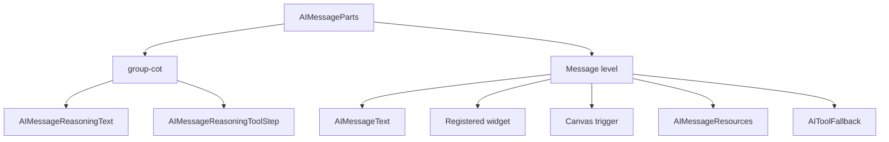
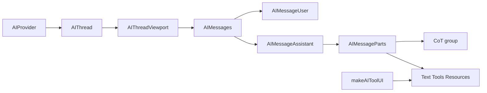

# Messages guide

> **Status:** experimental

Shoreline-styled message rendering for AI apps: the **`AIMessage*`** family from `@vtex/shoreline-ai` (user bubble, assistant Chain of Thought, markdown text, tool widgets, resource attachments, thinking status, message actions). Mount inside `<AIProvider>` and typically inside `AIThreadViewport`.

Related guides: [THREAD.md](./THREAD.md) (viewport layout), [PROVIDER.md](./PROVIDER.md), [HOOKS.md](./HOOKS.md) (message part hooks), [TOOL-UI.md](./TOOL-UI.md) (`makeAIToolUI`, canvas), [RUNTIME.md](./RUNTIME.md) (`AIMessage` / `AIMessagePart` model).

**Prerequisites:** `<AIProvider runtime={runtime}>` wrapping your chat UI. Import `@vtex/shoreline/css` and `@vtex/shoreline-ai/css`. Wrap with `LocaleProvider` so built-in labels use the `en-US` / `pt-BR` catalogs.

## Setup

```tsx
import '@vtex/shoreline/css'
import '@vtex/shoreline-ai/css'

import { LocaleProvider } from '@vtex/shoreline'
import {
  AIProvider,
  AIThread,
  AIThreadViewport,
  AIThreadEmpty,
  AIThreadViewportFooter,
  AIMessages,
} from '@vtex/shoreline-ai'
```

## Quick start

Normative tree: message list inside the thread viewport, between the empty slot and the sticky footer.

```tsx
<LocaleProvider locale="pt-BR">
  <AIProvider runtime={runtime}>
    <AIThread>
      <AIThreadViewport autoScroll>
        <AIThreadEmpty>{/* welcome */}</AIThreadEmpty>
        <AIMessages />
        <AIThreadViewportFooter>
          {/* scroll-to-bottom, composer, alerts */}
        </AIThreadViewportFooter>
      </AIThreadViewport>
    </AIThread>
  </AIProvider>
</LocaleProvider>
```

Drop-in usage requires no props — user and assistant layouts, CoT grouping, markdown, tool routing, the thinking status and the actions row are handled internally.

The docs site has a page with live examples: `/components/ai-messages` (and `/components/ai-thread`).

## Message part model

Each message is an `AIMessage` with a `parts` array. Parts are typed as `AIMessagePart`:

| Type | Fields | Default rendering |
|------|--------|-------------------|
| `text` | `text` | `AIMessageText` → GFM markdown |
| `reasoning` | `text`, `status: 'streaming' \| 'complete'` | CoT panel → `AIMessageReasoningText` |
| `tool` | `name`, `args`, `output`, `status`, `error?`, `metadata?` | Widget, canvas trigger, CoT step, or fallback |
| `resource` | `uri`, `name`, `mimeType` | Image preview or file row |

Full message shape and transport details: [RUNTIME.md](./RUNTIME.md). Read thread history via `useAIThread().messages`.

## Components

### List and layout

| Component | Purpose |
|-----------|---------|
| `AIMessages` | Full message list — drop-in with default user/assistant templates |
| `AIMessageUser` | User message shell (right-aligned bubble) |
| `AIMessageAssistant` | Assistant message shell (left-aligned, CoT + tools). Also renders `AIThinkingIndicator` while the run has no content yet and `AIMessageActions` once the message is complete and has text |
| `AIMessageRoot` | Single-message container; sets `messageRole` |
| `AIMessageParts` | Part iteration, CoT grouping, optional custom renderer |

### Content

| Component | Purpose |
|-----------|---------|
| `AIMessageText` | Text part rendered as markdown |
| `AIMarkdown` | Standalone GFM markdown (no streaming cursor) |
| `AIMessageReasoningRoot` | Collapsible CoT panel. Takes `status`, `duration`, `defaultExpanded`, `expanded`, `onExpandedChange` |
| `AIMessageReasoningTrigger` | Expand/collapse button. Label is "Reasoning" while `status="running"`, "Reasoned" otherwise |
| `AIMessageReasoningContent` | Collapsible body |
| `AIMessageReasoningText` | Reasoning text inside CoT |
| `AIMessageReasoningToolStep` | Compact step for unregistered tools in CoT |
| `AIThinkingIndicator` | Dots plus the `thinking` label, with `role="status"`. Shown before the first content arrives |
| `AIMessageActions` | Row under a completed assistant message: copy button first, then `children` |
| `AIMessageCopy` | Copies the text parts of the message. `onCopied` runs after a successful copy |
| `AIMessageResources` | Container for resource parts |
| `AIMessageResource` | Auto image or file chip |
| `AIMessageResourceImage` | Image preview variant |
| `AIMessageResourceFile` | File row variant |

### Helpers

| Export | Purpose |
|--------|---------|
| `renderDefaultParts(part, meta, options?)` | Built-in renderer — use as fallback in hybrid overrides |
| `defaultMessageGroupBy(part, ctx)` | The default grouping rule: reasoning and unregistered tools go to `group-cot`; everything else returns `null` (message level) |

## Composition variants

### Drop-in (default)

```tsx
<AIMessages />
```

Renders every message with built-in `AIMessageUser` and `AIMessageAssistant` presets. User messages appear as a right-aligned bubble; assistant messages show CoT, text, registered tools, and attachments.

### Explicit templates

Pass at most **one** `AIMessageUser` and **one** `AIMessageAssistant` as children. Duplicates throw at runtime.

```tsx
<AIMessages showReasoningTools={false}>
  <AIMessageUser />
  <AIMessageAssistant showReasoningTools={false} />
</AIMessages>
```

Use explicit templates when you need to wrap or change assistant content without reimplementing the message list. `AIMessageAssistant` still adds its own thinking indicator and actions row around the children you pass.

### Custom part renderer

`AIMessageParts` accepts a function child `(part, meta) => ReactNode`. Return a node to replace default rendering for that part; return `null` or `undefined` to fall through to the built-in renderer.

```tsx
<AIMessages>
  <AIMessageAssistant>
    <AIMessageParts>
      {(part, meta) =>
        part.type === 'text' ? (
          <p data-app-custom-text>{part.text}</p>
        ) : null
      }
    </AIMessageParts>
  </AIMessageAssistant>
</AIMessages>
```

### Hybrid override (HITL or single tool)

Handle one part type locally; delegate everything else to `renderDefaultParts`:

```tsx
import { AIMessageParts, renderDefaultParts } from '@vtex/shoreline-ai'

<AIMessageParts>
  {(part, meta) => {
    if (part.type === 'tool' && part.name === 'hitl-approve') {
      return (
        <HitlWidget
          args={part.args}
          status={part.status}
          output={part.output}
          metadata={part.metadata}
        />
      )
    }
    return renderDefaultParts(part, meta)
  }}
</AIMessageParts>
```

Local overrides take precedence over globally registered `makeAIToolUI` components on the same surface.

### Hide CoT tool steps

Set `showReasoningTools={false}` on `AIMessages`, `AIMessageAssistant`, or `AIMessageParts`. Reasoning text still renders inside the CoT panel; compact tool steps for unregistered tools are omitted.

Registered widget and canvas tools always render at message level regardless of this flag.

### Explicit resource variants

For isolated rendering outside the automatic part flow, use explicit variants instead of a generic escape prop:

```tsx
<AIMessageResourceImage />
<AIMessageResourceFile />
```

Inside the default flow, `AIMessageResource` picks the variant from the current part scope.

### Standalone reasoning compound

Build a custom CoT layout without changing grouping rules:

```tsx
<AIMessageReasoningRoot status={isStreaming ? 'running' : 'complete'}>
  <AIMessageReasoningTrigger />
  <AIMessageReasoningContent>
    <AIMessageReasoningText />
  </AIMessageReasoningContent>
</AIMessageReasoningRoot>
```

`AIMessageReasoningTrigger` and `AIMessageReasoningContent` must be used inside `AIMessageReasoningRoot`. All reasoning pieces (and `AIThinkingIndicator`, `AIMessageActions`, `AIMessageCopy`) read their labels from the `AIMessages` catalog, so mount them under an `AIMessages` list. `AIMessageReasoningText` reads the current reasoning part, so it only works where `AIMessageParts` renders a reasoning part.

For a controlled panel pass `expanded` and `onExpandedChange`; `defaultExpanded` is then ignored.

#### Reasoning row, dots and "Worked for"

In the default flow `AIMessageParts` draws a row above each CoT group: the trigger, then a meta span. The meta span shows animated dots while `status` is `running`, and `Worked for {duration}` once the group is `complete` and a duration is known (for example `Worked for 1 min 30 sec`, formatted for the active locale, minimum `1 sec`). The meta span is an internal piece and is not exported, so a panel composed by hand with `AIMessageReasoningRoot` never shows it, even with `duration`.

The duration comes from the timing of the reasoning group. The runtime does not supply it yet, so today "Worked for" stays hidden and only the dots and the "Reasoning"/"Reasoned" label appear.

### Actions and copy

`AIMessageAssistant` renders `AIMessageActions` after its children when the message is complete and has at least one non-empty text part. `AIMessageActions` renders `AIMessageCopy` first, then its `children`.

`AIMessageCopy` writes the text parts of the message (joined by a blank line) to the clipboard. On success the icon becomes a check for 2 seconds (`data-copied` is set), `onCopied` is called once, and a visually hidden live region announces `messageCopied`. No toast is shown. If the clipboard is unavailable or rejects, nothing changes.

The row is hidden (`opacity: 0`) until the message is hovered or has focus inside, so keyboard users reveal it with `Tab`. On `(hover: none)` devices it is always visible.

`AIMessageAssistant` always renders its own thinking indicator and actions row, also when you pass custom `children`, so do not add your own copy button or indicator inside it. An opt-out is planned with the feedback work.

Messages with status `incomplete` (for example a cancelled run) never show the actions row, so a partial answer cannot be copied.

The drop-in `AIMessageAssistant` has no slot for extra buttons: it renders its own actions row, so a second `AIMessageActions` inside it would draw two rows. To add buttons (for example feedback), compose the message from `AIMessageRoot messageRole="assistant"`, `AIMessageParts` and your own `AIMessageActions` with the buttons as `children`. Such a list needs the message labels and the engine message context, which `AIMessages` provides; `MessageMessagesProvider` is not exported from the package root yet.

### Thinking indicator

`AIMessageAssistant` shows `AIThinkingIndicator` while the message is running and has no non-empty text, reasoning or tool part yet. It disappears when the first of those arrives. You can render it yourself and pass `label` to override the text.

### User bubble width

The bubble is plain CSS on `[data-sl-ai-message-role="user"] [data-sl-ai-message-content]`. Its maximum width is `--sl-ai-message-user-max-width` (default `33.75rem`).

### Static markdown

Use `AIMarkdown` outside the message stream for docs, previews, or non-streaming content:

```tsx
<AIMarkdown>{'# Hello\n\nParagraph with **bold**.'}</AIMarkdown>
```

## Chain of Thought and tool routing

Assistant parts are grouped automatically. Reasoning and unregistered tools belong to the CoT group; text, resources, and registered tools render at message level.



| Part | `makeAIToolUI` registration | `showReasoningTools` | Renders at |
|------|----------------------------|----------------------|------------|
| `reasoning` | — | — | CoT panel |
| `tool` (no UI) | none | `true` | CoT step |
| `tool` (no UI) | none | `false` | Omitted from CoT; fallback at message level |
| `tool` | `widget` | any | Message level (inline widget) |
| `tool` | `canvas` | any | Message level (trigger + `<AICanvas>`) |
| `text`, `resource` | — | — | Message level |

Register tools at app setup with `makeAIToolUI` — see [TOOL-UI.md](./TOOL-UI.md). Mount registered tool components once under `<AIProvider>`.

During streaming, adjacent CoT members coalesce into one collapse panel so reasoning and tool steps appear in arrival order.

## Accessing state

### Inside a custom renderer — `AIMessagePartMeta`

Every function child on `AIMessageParts` receives a second argument with derived context:

```ts
type AIMessagePartMeta = {
  index: number
  isStreaming: boolean
  placement: 'cot' | 'message'
  toolRegistration: AIToolRegistration | null
}
```

| Field | Use |
|-------|-----|
| `index` | 0-based position of the part in the message |
| `isStreaming` | `true` while the part is actively updating |
| `placement` | `'cot'` inside the reasoning panel; `'message'` at message level |
| `toolRegistration` | Registry entry when the part is a registered tool; otherwise `null` |

Prefer `meta.isStreaming` and `meta.placement` in custom renderers instead of subscribing to the full thread state.

### Message part hooks

Use inside `<AIProvider>`. Omit `messageId` when called inside an `AIMessage*` tree; pass `messageId` to read a specific message from elsewhere.

| Hook | Returns | When to use |
|------|---------|-------------|
| `useAIMessageParts(messageId?)` | `AIMessagePart[]` | Full normalized model — **preferred** |
| `useAIReasonings(messageId?)` | `AIReasoningPart[]` | Reasoning parts only |
| `useAITools(messageId?)` | `AIToolPart[]` | Tool parts only |
| `useAIResources(messageId?)` | `AIResourcePart[]` | Resource parts only: files the user attached and resources your transport yields |

Details and examples: [HOOKS.md](./HOOKS.md#message-hooks).

### Thread-level hooks

```ts
const { messages, loadMessages, sendMessage } = useAIThread()
const { isStreaming } = useAIStatus()
```

Example — sidebar preview of the last assistant reply:

```tsx
import { useAIThread, useAIMessageParts } from '@vtex/shoreline-ai'

function LastAssistantSummary() {
  const { messages } = useAIThread()
  const last = [...messages].reverse().find((m) => m.role === 'assistant')
  const parts = useAIMessageParts(last?.id)
  const text = parts.find((p) => p.type === 'text')?.text

  if (!text) return null

  return <p>{text.slice(0, 120)}…</p>
}
```

## Props reference

### `<AIMessages>`

| Prop | Default | Purpose |
|------|---------|---------|
| `showReasoningTools` | `true` | Compact tool steps inside CoT for unregistered tools |
| `messages` | — | Partial i18n override |
| `children` | — | Optional `AIMessageUser` + `AIMessageAssistant` templates |

Also accepts native `div` attributes.

### `<AIMessageAssistant>`

| Prop | Default | Purpose |
|------|---------|---------|
| `showReasoningTools` | `true` | Same as on `AIMessages` |
| `children` | `AIMessageParts` | Compose `AIMessageParts` and siblings. The thinking indicator and the actions row are always added after them |

### `<AIMessageParts>`

| Prop | Default | Purpose |
|------|---------|---------|
| `showReasoningTools` | `true` | Same as above |
| `children` | — | Optional `(part, meta) => ReactNode` renderer |

### `<AIMessageReasoningRoot>`

| Prop | Default | Purpose |
|------|---------|---------|
| `status` | `'complete'` | `'running'` or `'complete'`. Drives the trigger label and the `data-status` attribute |
| `duration` | — | Time spent reasoning, in milliseconds. Only used by the internal meta span |
| `defaultExpanded` | `false` | Whether the CoT panel starts open (uncontrolled) |
| `expanded` | — | Controlled expanded state. `defaultExpanded` is ignored when set |
| `onExpandedChange` | — | Called with the next state whenever the trigger is toggled |

### `<AIMessageReasoningTrigger>`

| Prop | Purpose |
|------|---------|
| `label` | Override collapse button label. Default is the localized `reasoningStreaming` / `reasoningReady` |

Also accepts native `button` attributes.

### `<AIThinkingIndicator>`

| Prop | Purpose |
|------|---------|
| `label` | Override the label next to the dots. Default is the localized `thinking` |

### `<AIMessageActions>`

| Prop | Purpose |
|------|---------|
| `children` | Extra actions rendered after the copy button |

### `<AIMessageCopy>`

| Prop | Purpose |
|------|---------|
| `onCopied` | Called once after the message text is copied successfully |

Also accepts native `button` attributes (`onClick` runs before the copy).

### `<AIMarkdown>`

| Prop | Purpose |
|------|---------|
| `children` | Markdown source string |

`AIMessageUser`, `AIMessageRoot`, `AIMessageText`, and resource components accept standard `div` HTML attributes. `AIMessageReasoningToolStep` requires a `part: AIToolPart` prop when used standalone.

## i18n

Built-in locales: `en-US`, `pt-BR`.

| Message id | Default (`en-US`) | Default (`pt-BR`) | Used by |
|------------|-------------------|-------------------|---------|
| `reasoningStreaming` | Reasoning | Raciocinando | Trigger while `status="running"` |
| `reasoningReady` | Reasoned | Raciocinado | Trigger when `status="complete"` |
| `workedFor` | Worked for {duration} | Trabalhou por {duration} | Reasoning meta span (needs a known duration) |
| `thinking` | Thinking | Pensando | `AIThinkingIndicator` |
| `copyMessage` | Copy message | Copiar mensagem | `AIMessageCopy` button label |
| `messageCopied` | Message copied | Mensagem copiada | Live-region announcement after a copy |
| `copyCode` | Copy code | Copiar código | Not used yet; reserved for code blocks (markdown follow-up) |

Override only on the root:

```tsx
<AIMessages messages={{ reasoningReady: 'Finished reasoning' }} />
```

Unset keys fall back to the active `LocaleProvider` catalog.

## Styling hooks

Import package CSS once:

```tsx
import '@vtex/shoreline-ai/css'
```

Stable `data-sl-*` hooks for app overrides. Use only `--sl-*` tokens inside `@layer sl-components`.

| Attribute | Region |
|-----------|--------|
| `[data-sl-ai-messages]` | Message list |
| `[data-sl-ai-message]` | Message row. Uses `content-visibility: auto` (see below). Do not override its `padding` or `margin` |
| `[data-sl-ai-message][data-sl-ai-message-role="user"]` | User message — right-aligned |
| `[data-sl-ai-message][data-sl-ai-message-role="assistant"]` | Assistant message — left-aligned |
| `[data-sl-ai-message-content]` | Message content wrapper |
| `[data-sl-ai-message-parts]` | Parts container |
| `[data-sl-ai-message-reasoning]` | CoT panel. Has `data-status="running" \| "complete"` |
| `[data-sl-ai-message-reasoning-row]` | Row with the trigger and the meta span |
| `[data-sl-ai-message-reasoning-trigger]` | CoT expand/collapse control |
| `[data-sl-ai-message-reasoning-trigger-icon]` | Caret icon inside the trigger |
| `[data-sl-ai-message-reasoning-meta]` | Dots while running, "Worked for {duration}" when known |
| `[data-sl-ai-message-reasoning-content]` | CoT body (left border) |
| `[data-sl-ai-message-reasoning-text]` | One reasoning step |
| `[data-sl-ai-message-reasoning-tool-step]` | Compact tool step in CoT |
| `[data-sl-ai-message-text]` | Text part |
| `[data-sl-ai-markdown]` | Markdown output |
| `[data-sl-ai-dots-loader]` | Animated dots (reasoning meta, thinking indicator) |
| `[data-sl-ai-thinking-indicator]` | Thinking status (`role="status"`) |
| `[data-sl-ai-message-actions]` | Actions row under a completed assistant message |
| `[data-sl-ai-message-copy]` | Copy button. Has `data-copied` for 2 seconds after a copy |
| `[data-sl-ai-message-copy-status]` | Live region with the `messageCopied` announcement |
| `[data-sl-ai-message-resources]` | Resource attachments row |
| `[data-sl-ai-message-resource]` | Single attachment chip |
| `[data-sl-ai-message-resource-image]` | Image preview |
| `[data-sl-ai-message-resource-icon]` | File icon |
| `[data-sl-ai-message-resource-info]` | File name and mime type |

User bubble styling is applied via CSS on `[data-sl-ai-message-role="user"] [data-sl-ai-message-content]` — no dedicated bubble component.

| CSS variable | Default | Purpose |
|--------------|---------|---------|
| `--sl-ai-message-user-max-width` | `33.75rem` | Maximum width of the user bubble |
| `--sl-ai-message-intrinsic-size` | `5rem` | Placeholder height of a message row that was not rendered yet |

### `content-visibility`

Every `[data-sl-ai-message]` uses `content-visibility: auto` and `contain-intrinsic-block-size: auto var(--sl-ai-message-intrinsic-size, 5rem)`, so off-screen rows skip layout and paint in long threads. Because this clips painting to the row box, the row has `padding: var(--sl-space-2) var(--sl-space-4)`, a negative margin that cancels it, and `box-sizing: content-box`, so focus rings and the reasoning trigger (which sits left of the content) are not cut off. The content keeps the same width and position as without the padding, but the row box itself extends by `--sl-space-4` on each side of the messages container. A focus ring at the very edge of the container is therefore still clipped by an ancestor with `overflow: hidden`, such as `AIThreadViewport`: give the messages container (or the viewport) about `1rem` of horizontal padding. Consumers must not override `padding`, `margin` or `box-sizing` on `[data-sl-ai-message]`. Heights of rows that were never on screen are estimates, so the scroll bar can shift slightly in long histories.

## Migration: `AIMessageReasoningHeader` removed

`AIMessageReasoningHeader` (and the `streaming` prop of `AIMessageReasoningTrigger`) were removed. This is a breaking change. The row, the dots and the duration are now part of the message parts.

```tsx
// Before
<AIMessageReasoningRoot>
  <AIMessageReasoningHeader streaming={isStreaming} />
  <AIMessageReasoningContent>{/* ... */}</AIMessageReasoningContent>
</AIMessageReasoningRoot>

// After
<AIMessageReasoningRoot status={isStreaming ? 'running' : 'complete'}>
  <AIMessageReasoningTrigger />
  <AIMessageReasoningContent>{/* ... */}</AIMessageReasoningContent>
</AIMessageReasoningRoot>
```

A panel built by hand with `AIMessageReasoningRoot` shows no running dots and no "Worked for" text, because the row and the meta span are internal to `AIMessageParts` and are not exported. For the same reason, `duration` on the root only matters for the built-in row.

Selector change: `[data-sl-ai-message-reasoning-header]` is replaced by `[data-sl-ai-message-reasoning-row]`. The trigger label changed from "Reasoning…" / "Reasoning" to "Reasoning" / "Reasoned".

## Best practices

### Composition

- Start with `<AIMessages />` and add explicit templates only when layout requirements grow.
- Override individual parts via `AIMessageParts` function children — do not reimplement the full message list or CoT grouping.
- Prefer explicit variants (`AIMessageResourceImage`, `AIMessageResourceFile`) over generic props when rendering resources in isolation.
- Local `AIMessageParts` overrides win over global `makeAIToolUI` on the same surface.

### Performance

- In custom renderers, read `meta.isStreaming` and `meta.placement` instead of subscribing to the entire thread.
- When building custom hooks, avoid selectors that return new object references on every render — subscribe to simple values (strings, numbers, booleans) separately.
- Import from `@vtex/shoreline-ai` barrel exports; avoid deep package paths.
- Return `null` early for parts you do not customize; call `renderDefaultParts` for the rest.

### Shoreline

- Import `@vtex/shoreline/css` and `@vtex/shoreline-ai/css` once at the app root.
- Style overrides through `data-sl-*` selectors and `--sl-*` tokens.
- Keep `LocaleProvider` above the chat tree for localized labels.

### Anti-patterns

| Avoid | Prefer |
|-------|--------|
| Duplicating CoT grouping logic | Default grouping via `AIMessageParts`. `defaultMessageGroupBy` is exported for reading the rule, but `AIMessageParts` has no `groupBy` prop |
| Replacing `AIMessageText` with a controlled local textarea for streaming | `AIMessageParts` override that reads `meta.isStreaming` |
| Styling user bubbles with ad hoc classes | `[data-sl-ai-message-role="user"]` + tokens, or `--sl-ai-message-user-max-width` |
| Overriding `padding` / `margin` on `[data-sl-ai-message]` | Leave them; they keep focus rings from being clipped |

## Integration overview



Mount `<AICanvas />` alongside the thread when using canvas-mode tools. Thread layout details: [THREAD.md](./THREAD.md).
