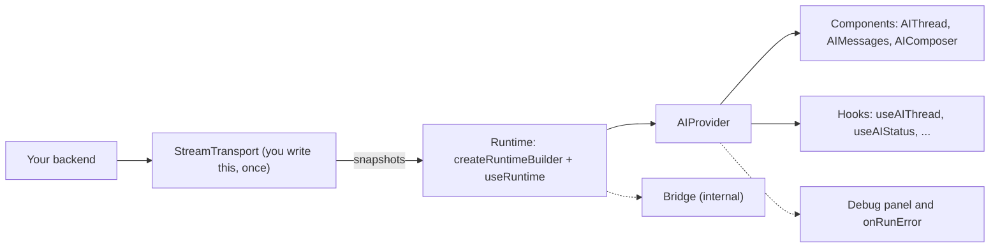

# @vtex/shoreline-ai: overview

> **Status:** experimental. The package is not published yet and the API can change.

`@vtex/shoreline-ai` gives you React components and hooks for an AI chat: the thread, the messages and the composer. You bring the backend as a small object called a stream transport. The package does the rest.

## How the pieces fit



Your transport talks to your backend and sends back snapshots of the assistant message. `createRuntimeBuilder` and `useRuntime` turn the transport into a runtime. `<AIProvider>` shares the runtime with the hooks (`useAIThread`, `useAIStatus`, ...) and the components (`AIThread`, `AIMessages`, `AIComposer`). The debug panel and the run error callback watch that same flow, so you do not wire them to the transport.

## Who does what

| Piece | What it is | Who writes it |
|-------|-----------|---------------|
| **Transport** | Talks to your backend and turns its events into snapshots of the assistant message. Your UI protocol is implemented here. It is the most complex piece, and you write it **once** | You |
| **Runtime** | Joins the transport with the chat engine and controls a run: send, stream, fail and cancel | The package |
| **Provider** | Shares the runtime with the hooks and the components, and keeps the thread id, the open canvas and the run error | The package |
| **Components and hooks** | The thread, the messages, the composer and the hooks that read them | The package |
| **Bridge** | Internal layer that translates messages between the format of this package and the one of the chat engine. You never use it | The package |

If you only read one thing, read [Runtime](./RUNTIME.md#a-realistic-transport): a real transport in about 90 lines.

## A minimal chat

```tsx
import '@vtex/shoreline-ai/css'

import { useMemo } from 'react'
import {
  AIComposer,
  AIComposerAction,
  AIComposerActions,
  AIComposerField,
  AIComposerFooter,
  AIComposerInput,
  AIMessages,
  AIProvider,
  AIThread,
  AIThreadViewport,
  createRuntimeBuilder,
  useRuntime,
  type StreamTransport,
} from '@vtex/shoreline-ai'

const transport: StreamTransport = {
  async *run({ trigger }) {
    const first = trigger.message.parts[0]
    const question = first?.type === 'text' ? first.text : ''

    yield { parts: [{ type: 'text', text: 'Thinking...' }], status: 'streaming' }

    return { parts: [{ type: 'text', text: `You asked: ${question}` }], status: 'ready' }
  },
}

export function MinimalChat() {
  const built = useMemo(() => createRuntimeBuilder().transport(transport).build(), [])
  const runtime = useRuntime(built)

  return (
    <AIProvider runtime={runtime}>
      <AIThread>
        <AIThreadViewport>
          <AIMessages />
        </AIThreadViewport>
        <AIComposer>
          <AIComposerField>
            <AIComposerInput />
            <AIComposerFooter>
              <AIComposerActions>
                <AIComposerAction />
              </AIComposerActions>
            </AIComposerFooter>
          </AIComposerField>
        </AIComposer>
      </AIThread>
    </AIProvider>
  )
}
```

## What the package covers

Each item has a short snippet and a link to its guide.

### Runtime

A `StreamTransport` is an async generator. `yield` a snapshot while the answer grows and `return` the final one. Each snapshot holds all parts of the assistant message so far, plus a `status`. If the transport throws, or returns `status: 'error'`, the run fails cleanly: the user message stays, the assistant message ends as incomplete and the app is told. If the user cancels, the package stops reading from the generator, and that is not an error.

```ts
const failing: StreamTransport = {
  async *run() {
    yield { parts: [], status: 'streaming' }

    return { parts: [], status: 'error', errorMessage: 'The backend is down' }
  },
}
```

Guide: [RUNTIME.md](./RUNTIME.md)

### AIProvider

`<AIProvider>` wraps the chat. The `threads` adapter connects it to your server (`list`, `load`, `archive`). `onRunError` is called once when a run fails. You can control the thread id with `threadId` and `onThreadChange`, or leave it to the provider.

```tsx
const threads = useMemo<AIThreadAdapter>(
  () => ({
    list: () => api.listThreads(),
    load: (id) => api.getMessages(id),
    archive: (id) => api.archiveThread(id),
  }),
  []
)

<AIProvider
  runtime={runtime}
  threadId={threadId}
  onThreadChange={setThreadId}
  threads={threads}
  onRunError={(error) => toast.error(error.message)}
>
  {children}
</AIProvider>
```

Guide: [PROVIDER.md](./PROVIDER.md)

### useAIThreadList

Reads the thread list from the `threads` adapter. `archiveThread` hides a thread at once and puts it back if the server fails. `refresh` loads the list again.

```tsx
const { threads, archiveThread, refresh } = useAIThreadList()
```

Guide: [HOOKS.md](./HOOKS.md#useaithreadlist)

### useAIStatus

Tells you what the chat is doing: `idle`, `submitted` (run started, no content yet), `streaming`, `ready` or `error`. After a failed run, `error` is `{ type: 'run', message }`.

```tsx
const { status, error } = useAIStatus()

if (error) return <p role="alert">{error.message}</p>
```

Guide: [HOOKS.md](./HOOKS.md#useaistatus)

### Composer attachments

Register an `AttachmentHandler` on the builder to let users add files. The composer shows progress and errors on each chip. When the message is sent, the handler turns each file into a `resource` part that reaches your transport.

```ts
const handler: AttachmentHandler = {
  accept: 'image/*,.pdf',
  maxSize: 5 * 1024 * 1024,
  maxCount: 3,
  async *add() {
    yield { progress: 0.5, status: 'uploading' }
    yield { progress: 1, status: 'ready' }
  },
  async send(pending) {
    return {
      type: 'resource',
      uri: await uploadFile(pending.file),
      name: pending.name,
      mimeType: pending.contentType,
      size: pending.file.size,
    }
  },
  async remove() {},
}

const built = createRuntimeBuilder().transport(transport).attachments(handler).build()
```

A failed upload does not block sending: the message goes out without that file. To react to the failure, render your own chip and call `useAIAttachment()` inside it. It gives you the attachment, `remove`, and `retry` (only when a retry can work). Show a toast inside an effect, so it runs once:

```tsx
function UploadChip() {
  const { attachment, remove, retry } = useAIAttachment()
  const failed = attachment.status === 'error'

  useEffect(() => {
    if (failed) toast.error(attachment.error)
  }, [failed, attachment.error])

  return (
    <div>
      <span>{attachment.name}</span>
      {failed && retry && <button type="button" onClick={retry}>Try again</button>}
      <button type="button" onClick={remove}>Remove</button>
    </div>
  )
}

<AIComposerAttachments>{() => <UploadChip />}</AIComposerAttachments>
```

Guides: [COMPOSER.md](./COMPOSER.md#attachments), [RUNTIME.md](./RUNTIME.md#attachmenthandler)

### useAIResources

Lists the `resource` parts of a message, in order. That includes the files the user attached.

```tsx
const resources = useAIResources(messageId)

return <ul>{resources.map((r) => <li key={r.uri}>{r.name}</li>)}</ul>
```

Guide: [HOOKS.md](./HOOKS.md#message-hooks)

### Stream debug panel

While you build a transport, turn on `debugStream` and add the panel. It lists every snapshot of each run as raw JSON, with a **Copy JSON** button and the part types in each row. Add a `debug` field to a snapshot to see your own raw data in that JSON. The package never reads it.

```tsx
<AIProvider runtime={runtime} debugStream>
  <AIStreamDebugPanel />
</AIProvider>
```

```ts
yield { parts, status: 'streaming', debug: event.raw }
```

Guide: [DEBUG.md](./DEBUG.md)

## Known limits

- Sending clears the whole draft. A failed attachment leaves `useAIComposer().attachments` when you send.
- A provider has one active thread. Switching thread cancels the active run. Use two providers to show two threads.
- The debug panel is for development only. Records stay in memory and are lost on reload.
- The package is experimental. Names and props can change before the first release.

## Where to go next

| Guide | What it covers |
|-------|----------------|
| [USAGE.md](./USAGE.md) | A full chat with a thread list |
| [RUNTIME.md](./RUNTIME.md) | Transport, builder, failure, cancel, attachments |
| [PROVIDER.md](./PROVIDER.md) | `AIProvider`, `threads`, `onRunError`, thread id |
| [HOOKS.md](./HOOKS.md) | All the hooks |
| [COMPOSER.md](./COMPOSER.md) | Composer parts, attachments, i18n |
| [THREAD.md](./THREAD.md) | Thread layout and scrolling |
| [MESSAGES.md](./MESSAGES.md) | Message rendering and overrides |
| [TOOL-UI.md](./TOOL-UI.md) | Tool calls and the canvas |
| [DEBUG.md](./DEBUG.md) | The stream debug panel |
