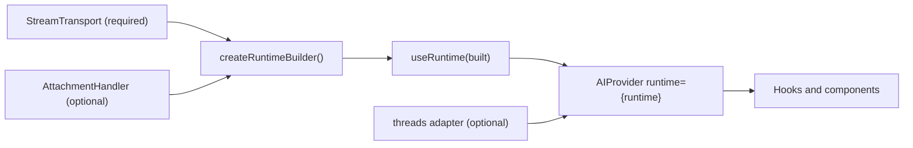
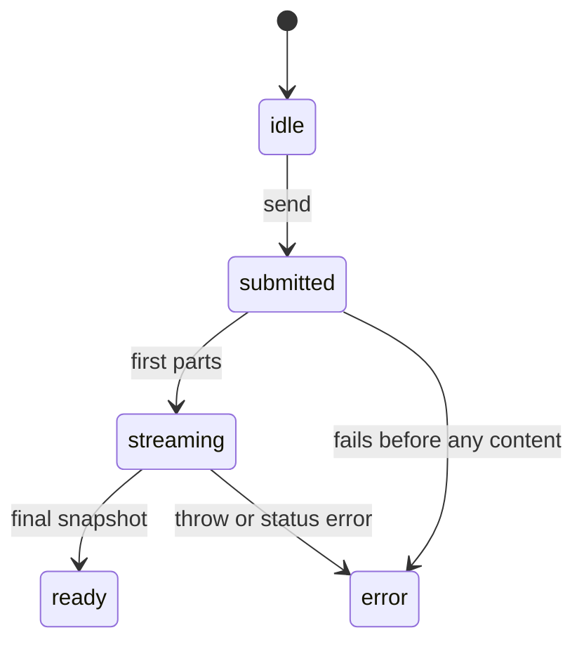

# Runtime guide

> **Status:** experimental

Write a **`StreamTransport`** for your backend. It is where your UI protocol is implemented: the most complex piece, written once. Then join it with **`createRuntimeBuilder`**, create the runtime with **`useRuntime`** and wrap your app in [**`<AIProvider>`**](./PROVIDER.md).

## How the pieces connect



## Concepts

| Concept | Role |
|---------|------|
| `AIMessage` / `AIMessagePart` | The message model: text, reasoning, tool and resource parts |
| `StreamTransport` | Your backend. It yields snapshots of the assistant message |
| `AttachmentHandler` | Optional. Uploads the files the user adds in the composer |
| `createRuntimeBuilder` | Joins the transport and the optional attachment handler |
| `useRuntime` | Creates the runtime to pass to `<AIProvider>` |
| `AIRuntime` | What `useRuntime` returns. Opaque: you only pass it to `<AIProvider>` |

## Quick start

```tsx
import { useMemo } from 'react'
import {
  AIProvider,
  createRuntimeBuilder,
  useRuntime,
  type StreamTransport,
} from '@vtex/shoreline-ai'

const echoTransport: StreamTransport = {
  async *run({ trigger }) {
    const text = trigger.message.parts.find((part) => part.type === 'text')
    const userText = text?.type === 'text' ? text.text : ''

    yield {
      parts: [{ type: 'text', text: `Echo: ${userText}` }],
      status: 'streaming',
    }

    return {
      parts: [{ type: 'text', text: `Echo: ${userText}` }],
      status: 'ready',
    }
  },
}

function ChatRoot({ children }: { children: React.ReactNode }) {
  const built = useMemo(
    () => createRuntimeBuilder().transport(echoTransport).build(),
    []
  )
  const runtime = useRuntime(built)

  return <AIProvider runtime={runtime}>{children}</AIProvider>
}
```

## A realistic transport

A real backend streams its answer in small events. This transport calls an endpoint, reads server-sent events and turns them into snapshots. The event names (`reasoning-delta`, `text-delta`, `error`, `done`) belong to this example: use the ones your backend sends.

What to notice:

- `abortSignal` goes to `fetch`, so a cancel stops the request.
- Every snapshot holds **all** parts so far, rebuilt from the text received until now, with the reasoning first.
- A failed request throws. An error event ends the run with `status: 'error'` and an `errorMessage`. Both reach `useAIStatus().error` and `onRunError`.
- `debug: event` puts the raw event in the [debug panel](./DEBUG.md).
- `threadId` tells the backend which conversation the run belongs to.

```ts
import type { AIMessagePart, StreamTransport } from '@vtex/shoreline-ai'

type ServerEvent =
  | { type: 'reasoning-delta'; text: string }
  | { type: 'text-delta'; text: string }
  | { type: 'error'; message: string }
  | { type: 'done' }

/** Reads `data: {json}` events from a server-sent events body. */
async function* readEvents(
  body: ReadableStream<Uint8Array>
): AsyncGenerator<ServerEvent> {
  const reader = body.getReader()
  const decoder = new TextDecoder()
  let buffer = ''

  while (true) {
    const { done, value } = await reader.read()

    if (done) break

    buffer += decoder.decode(value, { stream: true })

    const chunks = buffer.split('\n\n')

    buffer = chunks.pop() ?? ''

    for (const chunk of chunks) {
      const line = chunk.split('\n').find((l) => l.startsWith('data: '))

      if (line) yield JSON.parse(line.slice('data: '.length)) as ServerEvent
    }
  }
}

export function createSseTransport(url: string): StreamTransport {
  return {
    async *run({ trigger, threadId, abortSignal }) {
      const first = trigger.message.parts.find((p) => p.type === 'text')
      const question = first?.type === 'text' ? first.text : ''

      const response = await fetch(url, {
        method: 'POST',
        headers: { 'content-type': 'application/json' },
        body: JSON.stringify({ threadId, question }),
        signal: abortSignal,
      })

      if (!response.ok || !response.body) {
        throw new Error(`The request failed with status ${response.status}`)
      }

      let reasoning = ''
      let text = ''

      // Every snapshot holds all the parts so far, in the order they started.
      const toParts = (ended: boolean): AIMessagePart[] => {
        const parts: AIMessagePart[] = []

        if (reasoning) {
          // Reasoning is done as soon as the answer starts.
          const done = ended || text !== ''

          parts.push({
            type: 'reasoning',
            text: reasoning,
            status: done ? 'complete' : 'streaming',
          })
        }

        if (text) parts.push({ type: 'text', text })

        return parts
      }

      for await (const event of readEvents(response.body)) {
        if (event.type === 'error') {
          return {
            parts: toParts(true),
            status: 'error',
            errorMessage: event.message,
          }
        }

        if (event.type === 'done') break

        if (event.type === 'reasoning-delta') reasoning += event.text
        else text += event.text

        // `debug` is the raw event: it shows up in the debug panel.
        yield { parts: toParts(false), status: 'streaming', debug: event }
      }

      return { parts: toParts(true), status: 'ready' }
    },
  }
}
```

Use it like any other transport:

```tsx
const built = useMemo(
  () => createRuntimeBuilder().transport(createSseTransport('/api/chat')).build(),
  []
)
```

## `createRuntimeBuilder()`

```ts
const built = createRuntimeBuilder()
  .transport(myStreamTransport)
  .attachments(myAttachmentHandler) // optional
  .build()
```

| Method | Purpose |
|--------|---------|
| `.transport(transport)` | Sets your backend. Required: `.build()` throws without it |
| `.attachments(handler)` | Turns on file uploads in the composer. See [`AttachmentHandler`](#attachmenthandler) |
| `.build()` | Returns the value to pass to `useRuntime` |

Keep `built` stable between renders (for example with `useMemo`), so the runtime is not created again on every render.

## `StreamTransport`

```ts
interface StreamTransport {
  run(input: RuntimeRunInput): AsyncGenerator<RuntimeSnapshot, RuntimeSnapshot>
}

interface RuntimeRunTrigger {
  type: 'message'
  message: AIMessage // the user message that started the run
}

interface RuntimeRunInput {
  messages: AIMessage[] // the whole thread, including the user message
  trigger: RuntimeRunTrigger
  abortSignal: AbortSignal
  runResponseId: string // id of the assistant message this run creates
  threadId: string // id of the thread, from AIProvider
}

interface RuntimeSnapshot {
  parts: AIMessagePart[] // all parts of the assistant message so far
  status?: StreamStatus
  errorMessage?: string
  debug?: unknown
}
```

| Field | Purpose |
|-------|---------|
| `messages` | Full history, for backends that need context |
| `trigger.message` | The user turn that started the run. Backends that only need the latest message read this |
| `abortSignal` | Aborts when the user cancels or switches thread. Stop your request on it |
| `runResponseId` | Id of the assistant message, useful to match logs with the UI |
| `threadId` | Id of the thread the run belongs to. It comes from `AIProvider`: when no thread is open, the provider creates the id before the run starts and reports it with `onThreadChange`, see [PROVIDER.md](./PROVIDER.md#controlled-and-uncontrolled-thread-id). Send it to your backend so it knows the conversation |
| `yield` | A partial snapshot while the answer grows |
| `return` | The final snapshot when the answer ends |

Every snapshot holds **all** parts of the assistant message so far, not only the new ones. Do not change a snapshot after you yield it.

### Snapshot fields

| Field | Purpose |
|-------|---------|
| `parts` | The parts of the assistant message |
| `status` | `'streaming'` while the answer grows, `'ready'` when it ends. Return `'error'` in the final snapshot to fail the run |
| `errorMessage` | Text for a failed run. When the final snapshot has `status: 'error'` and no parts, the message shows this text. It is also the `message` of the run error |
| `debug` | Anything you want to see in the [stream debug panel](./DEBUG.md). The package stores it and never reads it |

### Run status



A cancelled run is not an error. `useAIStatus` reports these states, see [HOOKS.md](./HOOKS.md#useaistatus).

### Failure

If the transport throws, the run does not throw to your app. Instead:

- the user message stays in the thread;
- the assistant message ends as incomplete, with the error message as its text;
- `useAIStatus().status` is `'error'`;
- `useAIStatus().error` is `{ type: 'run', message }`;
- `onRunError` of [`<AIProvider>`](./PROVIDER.md) is called once.

Returning a final snapshot with `status: 'error'` has the same result, with one difference: if that snapshot has parts, the message keeps those parts. Without parts it shows `errorMessage`. When the transport gives no `errorMessage`, the message of the run error is `The run failed`. The error is cleared when the next message is sent or the thread changes. The app decides how to show it: read `useAIStatus().error` or use `onRunError` for a toast or a log. To try again, call `sendMessage` again.

### Cancel

When the user stops a run (`stopGeneration`, the stop button) or switches thread, `abortSignal` aborts. The package stops pulling snapshots from your generator at once, even if your code ignores the signal, and closes it. Cancel is not an error: `status` does not become `'error'` and `onRunError` is not called.

## `useRuntime`

```ts
const runtime = useRuntime(built)
```

Returns an `AIRuntime` for `<AIProvider runtime={runtime}>`. `AIRuntime` is opaque: its contents are not part of the public API. Thread operations (switch, create, load, stop) are available only through the hooks in [HOOKS.md](./HOOKS.md).

## Hydrate history

```ts
import { loadThreadMessages } from '@vtex/shoreline-ai'

loadThreadMessages(runtime, historyMessages)
```

Or from a component: `useAIThread().loadMessages(history)`, see [HOOKS.md](./HOOKS.md). With the `threads` adapter of [`<AIProvider>`](./PROVIDER.md), `threads.load` hydrates the thread for you when it opens.

## `AttachmentHandler`

```ts
interface AttachmentHandler {
  accept?: string // for example 'image/*,.pdf'. Default '*'
  maxSize?: number // bytes
  maxCount?: number // files in the composer at once
  add(file: File): AsyncIterable<AttachmentUploadState>
  send(pending: PendingAttachment): Promise<AIResourcePart>
  remove(pending: PendingAttachment): Promise<void>
}

interface AttachmentUploadState {
  progress: number // 0 to 1
  status: 'uploading' | 'ready' | 'error'
  error?: string // message for the chip when status is 'error'
}
```

Register it with `.attachments(handler)` on the builder.

```ts
const handler: AttachmentHandler = {
  accept: 'image/*,.pdf',
  maxSize: 5 * 1024 * 1024,
  maxCount: 3,
  async *add(file) {
    yield { progress: 0.5, status: 'uploading' }
    // upload the file here
    yield { progress: 1, status: 'ready' }
  },
  async send(pending) {
    return {
      type: 'resource',
      uri: await uploadFile(pending.file),
      name: pending.name,
      mimeType: pending.contentType,
      size: pending.file.size,
    }
  },
  async remove() {
    // delete the uploaded file
  },
}
```

How it works:

1. **`add`** runs when the user picks a file. Yield `uploading` states with a `progress` from 0 to 1, then `ready`. The composer shows the progress on the chip. To fail, yield `{ status: 'error', progress: 0, error: 'message' }`: do not throw. If `add` throws, the chip also shows an error.
2. **`accept`, `maxSize`, `maxCount`** are checked before `add` runs. `accept` also sets the file types the picker offers. A file that is too large or beyond `maxCount` shows an error chip and is not uploaded. A file whose type is not accepted shows a notice in the composer. See [COMPOSER.md](./COMPOSER.md#attachments).
3. **`send`** runs when the user sends the message. Return the resource of the uploaded file. It is not called for a file that failed: a failed file never blocks sending, and the message goes out without it (no `resource` part). See [COMPOSER.md](./COMPOSER.md#errors).
4. The sent file reaches your transport as a part with `type: 'resource'` in `trigger.message.parts` (and in `messages`), with `uri`, `name`, `mimeType` and `size`.
5. **`remove`** runs when the user removes a file that was added and not sent yet. Use it to delete the uploaded file.
6. The package releases its own state for the file (the preview and the pending entry) when the message is sent, when the file is removed and when the upload fails. The reason of a failed file, used for the chip message, is kept until the file is removed or the message is sent.

Resource parts of user messages stay in the history: they come back in `useAIThread().messages` and survive `loadThreadMessages`. A resource link in an assistant message (a `resource` part in a snapshot) shows as an image when `mimeType` starts with `image/` and as a file otherwise.

## Stream debug

To see every snapshot a transport sends, turn on `debugStream` in [`<AIProvider>`](./PROVIDER.md) and read [DEBUG.md](./DEBUG.md).

## Runtime limitations

| Area | Notes |
|------|-------|
| Background runs | Not supported. Switching thread cancels the active run |
| Threads per provider | One active thread per `<AIProvider>`. To show two threads at the same time, use two providers, see [PROVIDER.md](./PROVIDER.md#nested-and-sibling-providers) |
