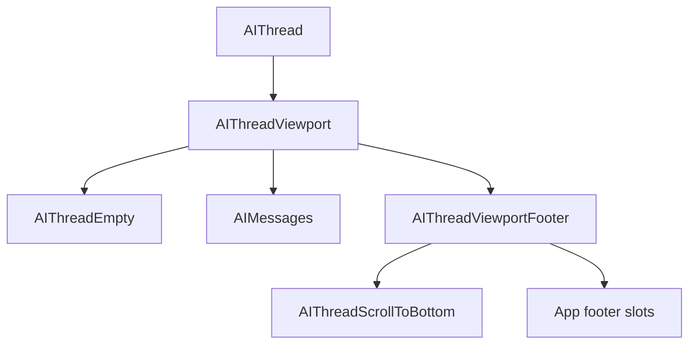

# Thread guide

> **Status:** experimental

Shoreline-styled chat **layout** for AI apps: the **`AIThread*`** family from `@vtex/shoreline-ai` (scrollable viewport, empty slot, sticky viewport footer, scroll-to-bottom). Mount inside `<AIProvider>`.

Related guides: [PROVIDER.md](./PROVIDER.md) (`threads` adapter), [HOOKS.md](./HOOKS.md) (`useAIThread`, `sendMessage`, multi-thread), [RUNTIME.md](./RUNTIME.md) (`loadThreadMessages`), [MESSAGES.md](./MESSAGES.md) (`AIMessages`).

**Prerequisites:** `<AIProvider runtime={runtime}>` wrapping your chat UI. Import `@vtex/shoreline/css` and `@vtex/shoreline-ai/css`. Wrap with `LocaleProvider` so built-in labels use the `en-US` / `pt-BR` catalogs.

## Setup

```tsx
import '@vtex/shoreline/css'
import '@vtex/shoreline-ai/css'

import { LocaleProvider } from '@vtex/shoreline'
import {
  AIProvider,
  AIThread,
  AIThreadViewport,
  AIThreadEmpty,
  AIThreadViewportFooter,
  AIThreadScrollToBottom,
  AIMessages,
  useAIThread,
} from '@vtex/shoreline-ai'
```

## Quick start

Normative tree: empty slot and message area inside the viewport; sticky footer with scroll control first, then app footer content.

```tsx
<LocaleProvider locale="pt-BR">
  <AIProvider runtime={runtime}>
    <AIThread>
      <AIThreadViewport autoScroll>
        <AIThreadEmpty>{/* welcome */}</AIThreadEmpty>
        <AIMessages />
        <AIThreadViewportFooter>
          <AIThreadScrollToBottom />
          {/* footer: input, alerts */}
        </AIThreadViewportFooter>
      </AIThreadViewport>
    </AIThread>
  </AIProvider>
</LocaleProvider>
```

**Child order inside `AIThreadViewport`:** `AIThreadEmpty` (optional) → `<AIMessages />` (optional) → `AIThreadViewportFooter` (when the surface has a fixed footer). Inside the footer, mount `AIThreadScrollToBottom` as the **first child** so it floats above later footer slots.

Message rendering, part overrides, and CoT grouping: [MESSAGES.md](./MESSAGES.md).

The docs site has a page with live examples: `/components/ai-thread`.

The scroll behavior comes from the chat engine the package is built on. Its version is pinned in the package `package.json` (`0.15.32` at the time of writing), so scroll details change only when the package updates it.

`AIThreadViewport` is the scroll container. `AIThreadViewportFooter` stays sticky at the bottom of the viewport. The scroll-to-bottom control is positioned above the footer via `[data-sl-ai-thread-scroll-to-bottom]`.

## Components

| Component | Purpose |
|-----------|---------|
| `AIThread` | Root container; optional `messages` overrides i18n |
| `AIThreadViewport` | Scrollable viewport with auto-scroll on new messages and thread switches |
| `AIThreadEmpty` | Renders children only when the thread is empty and not opening. Fills the free space and centers them |
| `AIThreadViewportFooter` | Sticky footer; height is measured for scroll inset |
| `AIThreadScrollToBottom` | Button to jump to the latest messages when not at the bottom |

## Composition variants

The quick start tree is the default. Use these variants only when behavior differs:

### Without scroll-to-bottom

Omit `AIThreadScrollToBottom` and keep only app content in the footer:

```tsx
<AIThreadViewportFooter>
  {/* footer slots */}
</AIThreadViewportFooter>
```

### Error banner in the footer

Read `useAIThread().error` and render an alert with `data-sl-ai-thread-error`. This error only reports a failed `threads.load`. To show run errors, read `useAIStatus().error` ([HOOKS.md](./HOOKS.md#useaistatus)).

```tsx
const { error } = useAIThread()
const openError = error?.type === 'thread_open' ? error.message : null

<AIThreadViewportFooter>
  <AIThreadScrollToBottom />
  {openError ? (
    <p role="alert" data-sl-ai-thread-error>
      {openError}
    </p>
  ) : null}
  {/* footer slots */}
</AIThreadViewportFooter>
```

### Opening a thread

`isOpeningThread` and `error` come from the `threads.load` method of the [`threads` adapter](./PROVIDER.md#threads-adapter) of `<AIProvider>`. `isOpeningThread` is `true` while `load` runs. If `load` rejects, `error` is `{ type: 'thread_open', message }`. Without `threads.load`, `isOpeningThread` is always `false` and `error` stays `null`.

While `useAIThread().isOpeningThread` is `true`:

- `AIThreadEmpty` does not render (avoids welcome flash before history hydrates).
- Mount loading UI in the footer in your app layer (for example a composer skeleton — see [COMPOSER.md](./COMPOSER.md)).



## `<AIThread>`

| Prop | Default | Purpose |
|------|---------|---------|
| `messages` | — | Partial override of the internal i18n catalog |
| `children` | — | Thread subtree (`AIThreadViewport`, etc.) |

Also accepts native `div` attributes (`className`, `style`, `id`, …).

Message ids: `scrollToBottom`.

```tsx
<AIThread messages={{ scrollToBottom: 'Ir para o fim' }} />
```

Only `AIThread` accepts `messages`; child components read from context.

## Subcomponent props

### `AIThreadViewport`

| Prop | Default | Purpose |
|------|---------|---------|
| `autoScroll` | `true` | Scroll to bottom when new messages arrive |
| `scrollToBottomOnRunStart` | `true` | Scroll to bottom when a new run starts |
| `scrollToBottomOnInitialize` | `true` | Scroll to bottom when thread history is first loaded |
| `scrollToBottomOnThreadSwitch` | `true` | Scroll to bottom when switching to a different thread |
| `children` | — | Empty slot, message area, footer |

Also accepts native `div` attributes.

### `AIThreadEmpty`

| Prop | Purpose |
|------|---------|
| `children` | Welcome or onboarding UI |

Standard `div` props. **Behavior:** renders children only when `useAIThread().isEmpty` is `true` and `isOpeningThread` is `false`; otherwise returns `null`. The slot grows to fill the free space and centers its children; it adds no other styles.

### `AIThreadViewportFooter`

| Prop | Purpose |
|------|---------|
| `children` | Footer slots (scroll control, input, alerts) |

Standard `div` props. Sticky at the bottom of the viewport; footer height is used to inset auto-scroll so content is not hidden behind the footer.

### `AIThreadScrollToBottom`

| Prop | Purpose |
|------|---------|
| `children` | Optional custom control content (default: the Material `expand_more` icon, 20px) |

Standard `button` props. When the viewport is already at the bottom the button is `disabled` and has `opacity: 0` with `pointer-events: none`, so it only appears after the user scrolls up. It is absolutely positioned above the footer (`bottom: 100%`), so mount it as the **first child** of `AIThreadViewportFooter`. The accessible name comes from the `scrollToBottom` message.

## Layout and spacing

The thread owns its layout, so a raw thread with no app CSS already looks right:

- **The composer sits at the bottom.** `AIThreadViewportFooter` has `margin-top: auto`, so in a short or empty thread the footer stays at the bottom of the viewport instead of floating under the last message.
- **Empty state.** `AIThreadEmpty` grows to fill the free space (`flex: 1`) and centers its children horizontally and vertically. Its children are still yours to style.
- **Default spacing.** The messages have 24px on the sides (`--sl-ai-thread-padding-inline`, default `var(--sl-space-6)`) and 16px above and below (`--sl-ai-thread-padding-block`, default `var(--sl-space-4)`). The footer has the same values on its sides and bottom (no top padding), so the composer lines up with the message column. `--sl-ai-thread-padding` sets both axes at once. The viewport hands that padding to `AIMessages` through `--sl-ai-messages-padding`, so it also applies when `AIMessages` sits inside a wrapper (see [Wrapping `AIMessages`](#wrapping-aimessages)). Apps do not need to pad the list themselves.
- **Gap between messages.** `var(--sl-ai-messages-gap, var(--sl-space-3))` (12px), the same distance as between the blocks of an answer. The same value is left below the last message.
- **Scroll button.** `AIThreadScrollToBottom` is a 28px round button with no border, centered 28px above the footer.

| Custom property | Default | What it changes |
|-----------------|---------|-----------------|
| `--sl-ai-thread-padding-inline` | `var(--sl-space-6)` | Padding on the sides of the messages and of the composer footer |
| `--sl-ai-thread-padding-block` | `var(--sl-space-4)` | Padding above and below the messages, and below the composer footer |
| `--sl-ai-thread-padding` | not set | Shortcut that sets both axes at once. A per-axis property wins over it |
| `--sl-ai-messages-gap` | `var(--sl-space-3)` | Gap between messages, and the space below the last message |
| `--sl-ai-messages-padding` | the thread padding inside `AIThreadViewport`, `0` elsewhere | Padding of `AIMessages`; set `0` on a wrapper that pads itself |

Set them on `[data-sl-ai-thread]` (or any ancestor):

```css
[data-sl-ai-thread] {
  --sl-ai-thread-padding-inline: var(--sl-space-8);
  --sl-ai-messages-gap: var(--sl-space-4);
}
```

### Wrapping `AIMessages`

`AIMessages` takes its padding from `--sl-ai-messages-padding` (default `0`), and keeps `--sl-ai-messages-gap` of room below the last message for its actions bar. `AIThreadViewport` sets `--sl-ai-messages-padding` to the thread padding, and custom properties are inherited, so the list gets the same spacing when your app wraps it in its own element: the composer stays aligned with the message column and the sticky footer does not cover the last bar.

If your wrapper already pads itself, turn the list padding off so it is not applied twice:

```css
.my-messages-wrapper {
  padding: var(--sl-space-6);
  --sl-ai-messages-padding: 0;
}
```

Outside a thread, `AIMessages` has no side padding, and still keeps the room below the last message.

## Scroll behavior

`AIThreadViewport` forwards its four props to the scrolling engine of the chat:

- `autoScroll`: keeps the viewport pinned to the end while new content arrives. Defaults to `true`.
- `scrollToBottomOnRunStart`, `scrollToBottomOnInitialize`, `scrollToBottomOnThreadSwitch`: jump to the end when a run starts, when history is first loaded, and when the thread changes. All default to `true`.

`AIThreadScrollToBottom` is the manual control for the same action. It is enabled only while the viewport is not at the bottom.

### Long threads and `content-visibility`

Each message row (`[data-sl-ai-message]`) uses `content-visibility: auto`, so rows that are off screen skip layout and paint. The browser does not know the height of a row that was never rendered and uses `--sl-ai-message-intrinsic-size` (default `5rem`) as a placeholder, then remembers the real height after the first render. The scroll bar can therefore shift slightly while scrolling up through a long history. Raise the variable if your messages are usually much taller. The row also has padding and a cancelling negative margin so focus rings are not clipped (the default thread spacing already gives the messages `1rem` of padding, also through a wrapper, so rings at the edge are not cut; see [Wrapping `AIMessages`](#wrapping-aimessages)); do not override `padding` or `margin` on `[data-sl-ai-message]`. Details: [MESSAGES.md](./MESSAGES.md#content-visibility).

## Types

Exported from `@vtex/shoreline-ai`:

| Type | Description |
|------|-------------|
| `AIThreadOptions` | `messages`, `children` |
| `AIThreadProps` | `AIThreadOptions` + `div` HTML attributes |
| `AIThreadViewportOptions` | Viewport scroll props + `children` |
| `AIThreadViewportProps` | `AIThreadViewportOptions` + `div` HTML attributes |
| `AIThreadEmptyProps` | `div` HTML attributes |
| `AIThreadViewportFooterProps` | `div` HTML attributes |
| `AIThreadScrollToBottomProps` | `button` HTML attributes |
| `AIThreadMessages` | `{ scrollToBottom?: string }` |

Thread errors surfaced on `useAIThread().error`:

| Type | Description |
|------|-------------|
| `AIThreadErrorType` | `'thread_open'`, `'thread_list'`, `'thread_archive'` or `'run'`. `useAIThread().error` only has `'thread_open'` |
| `AIThreadError` | `{ type: AIThreadErrorType; message: string }` |

## Hooks

Use `useAIThread()` inside `<AIProvider>` for thread layout and operations.

| Member | Use with `AIThread*` |
|--------|----------------------|
| `isEmpty` | `true` when the active thread has zero messages; mirrors when `AIThreadEmpty` would show |
| `isOpeningThread` | `true` while `threads.load` runs; suppresses `AIThreadEmpty` |
| `error` | `AIThreadError \| null`: `thread_open` when `threads.load` fails, for a footer alert |
| `messages` | Current thread as `AIMessage[]` |
| `threadId` | Active persistence id |
| `sendMessage` | Append user message and start a run |
| `stopGeneration` | Cancel the active run |
| `switchThread` | Cancel run, clear the thread, set active thread id |
| `createThread` | Cancel run, clear the thread, create a new id and return it. Does not call `threads.load` |
| `loadMessages` | Replace thread content from `AIMessage[]` |

```tsx
const { isEmpty, isOpeningThread, error, messages } = useAIThread()
const openError = error?.type === 'thread_open' ? error.message : null
```

`isEmpty` is derived from `messages.length === 0` on the active thread.

Full `sendMessage` shapes and multi-thread flows: [HOOKS.md](./HOOKS.md#useaithread).

## i18n

Built-in locales: `en-US`, `pt-BR` (see `components/thread/messages/` in the package).

| Message id | Default (`en-US`) |
|------------|-------------------|
| `scrollToBottom` | Scroll to bottom |

Override only on the root:

```tsx
<AIThread messages={{ scrollToBottom: 'Rolar para o final' }} />
```

Unset keys fall back to the active `LocaleProvider` catalog.

## Styling hooks

Import package CSS once:

```tsx
import '@vtex/shoreline-ai/css'
```

Stable `data-sl-*` hooks for app overrides:

| Attribute | Region |
|-----------|--------|
| `[data-sl-ai-thread]` | Root |
| `[data-sl-ai-thread-viewport]` | Scrollable viewport |
| `[data-sl-ai-thread-empty]` | Empty slot (fills the free space and centers its children) |
| `[data-sl-ai-thread-viewport-footer]` | Sticky footer |
| `[data-sl-ai-thread-scroll-to-bottom]` | Scroll control (floated above footer) |
| `[data-sl-ai-thread-error]` | App error banner in footer (convention) |
